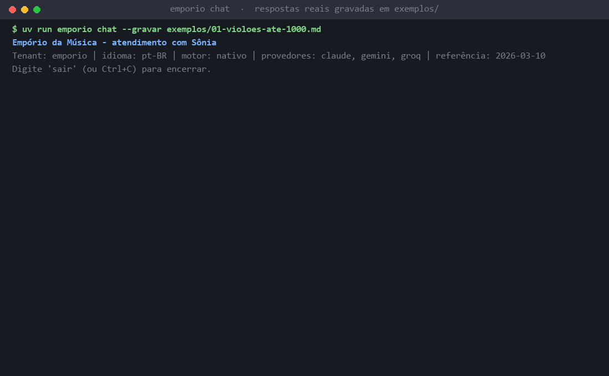
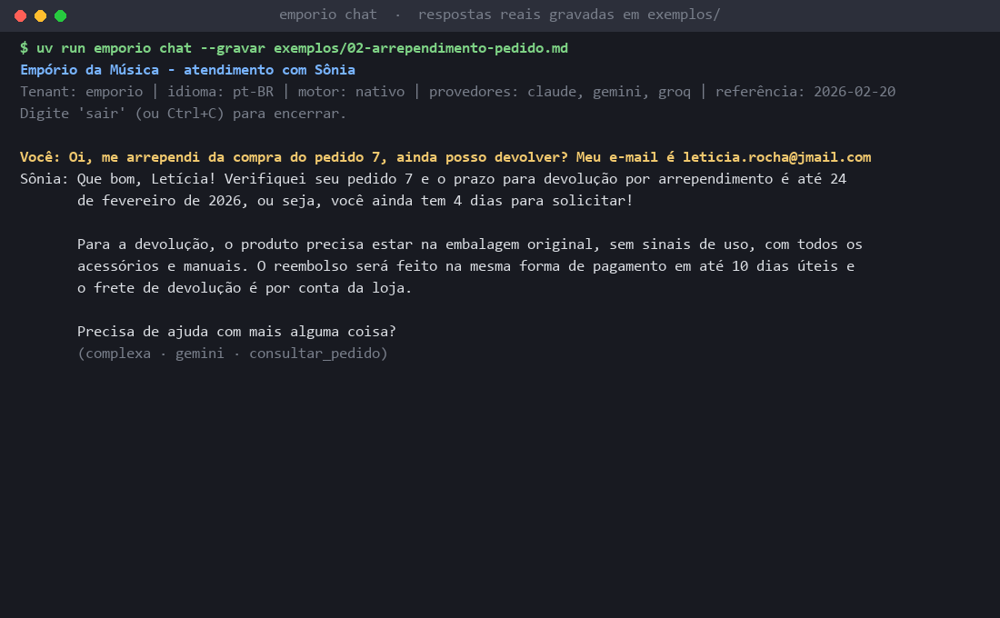
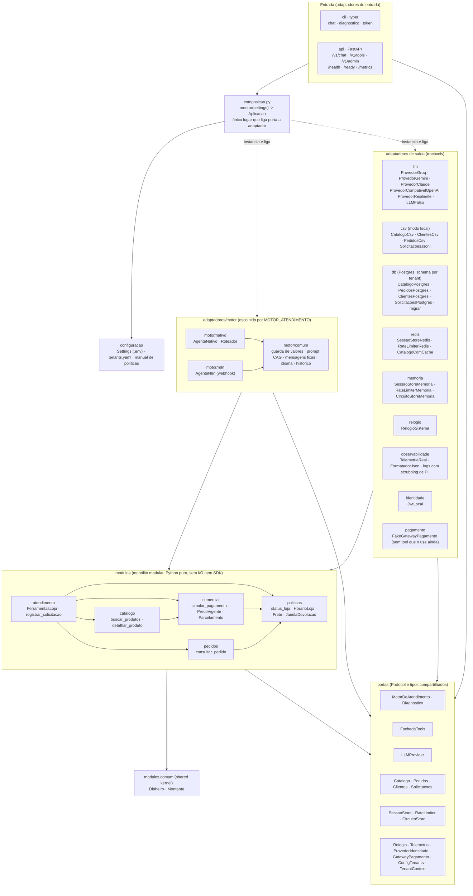

[Português (pt-BR)](README.md) · **English (en-US)**

# Empório da Música: Sônia, the customer service agent

> Process: [project board (3 epics, 9 stories, 29 tasks)](https://github.com/users/carlosbandelli/projects/4) · details in [How it was built](#how-it-was-built-process-and-board) · [architecture diagrams](#architecture-in-diagrams).

Text-based customer service agent for **Empório da Música**, a fictional musical instrument store in Campo Grande/MS,
Brazil. The assistant is called **Sônia**. She answers questions about price, stock, orders, opening hours, address,
installments, returns, warranty and shipping. Data comes from tools (CSV files or Postgres), and rules come from the
store's policy manual. The store does not sell accessories (strings, picks, cables, cases, pedals, amplifiers): Sônia
redirects those requests.

Artefact technical challenge, AI Engineer 2026.

The default language for answers is Brazilian Portuguese. English works with `--idioma en-US` and with language
detection (section 4.10).

**Delivery status:** Phase 1 (core) and Phase 2 (API, Postgres, Redis, observability, RBAC, tools over HTTP, n8n engine,
Docker Compose and CI) are implemented. Left out: a real payment gateway (only the simulated one), the WhatsApp channel,
Grafana, Sentry, and running the n8n workflow on a real n8n. See section 8.

---

## See it working



*GIF drawn from the real conversations recorded with an LLM in [`exemplos/`](exemplos/README.md): acoustic guitars up to R$ 1000 (catalog data and the installment rule) and, in English, the Takamine GD20 price, an out-of-scope accessory and the store address. The grey line shows `level · provider · tools`. Generated by [`scripts/gerar_demo.py`](scripts/gerar_demo.py).*



*Screenshot: "I regret my purchase, can I return it?" with order 7 verified by e-mail and the manual's 7-day window applied to the date.*

## Architecture: multi-tenant, stateless, scalable and swappable

The project is a **modular monolith in the middle, with hexagonal architecture (ports and adapters) at the edges**. Business rules are plain Python, with no I/O and no SDK; everything that talks to the outside world is a swappable adapter behind a port. `import-linter` (14 contracts, in CI) enforces inward-only dependencies.

| Property | How it is ensured |
|---|---|
| **Multi-tenant** | Every data or state access receives a `TenantContext` (port `portas/contexto.py`). Per-store config in `config/tenants.yaml` (persona, contacts, limits, manual). Postgres with a **schema per tenant** (`search_path` per transaction; a connection without a tenant sees no table). Redis keys prefixed with the tenant. In the API the tenant comes from `X-Tenant-ID` or the subdomain; the JWT must belong to the same tenant. Invariants I3 and I8 tested on all three engines. |
| **Stateless** | With `DATABASE_URL` and `REDIS_URL`, the application process keeps no conversation or data: session and rate limit in Redis, data in Postgres; any replica serves any message. No global state (composition rule). Kept in-process on purpose: circuit breaker and bulkhead per replica, and admin-edited config (#123). In local mode (no Redis) the session lives in process memory (#21). |
| **Scalable** | `docker compose` runs Traefik + **3 replicas** + Postgres + Redis (verified); the Redis rate limit applies across replicas; Kubernetes manifests with HPA 3–10 (example, not exercised). |
| **Swappable** | Each external dependency is a port whose adapters are chosen only in `composicao.py`, by configuration (table below). The I1–I8 contract suite proves the whole engine can be swapped: it passes the same for the native engine, through the API and for n8n. |

**Where the modular monolith is**: `src/emporio/modulos/` (business rules, plain Python).

| Module | Contents |
|---|---|
| `catalogo/` | products, categories, search, alternatives when out of stock, equivalents for discontinued items |
| `comercial/` | current price, PIX that does not stack with promotions, tiered installments, combined payment |
| `pedidos/` | order lookup with e-mail or phone verification |
| `politicas/` | opening hours and next opening, shipping, return, exchange and warranty windows |
| `atendimento/` | requests (complaint, quote), status and the facade of the 6 tools |
| `comum/` | shared kernel (`Dinheiro` in cents) |

Each module has `dominio.py` (rules) and `aplicacao.py` (use cases, the module's public API). A module never imports another module's `dominio` (contract C3).

**Where the hexagon is**: ports in `src/emporio/portas/`, adapters in `src/emporio/adaptadores/`.

| Port (contract) | Adapters | Side |
|---|---|---|
| `MotorDeAtendimento` (`motor.py`) | `motor/nativo` (`AgenteNativo`), `motor/n8n` (`AgenteN8n`) | agent core |
| (entry points; call the port above) | `cli` (Typer), `api` (FastAPI) | **inbound** |
| `FachadaTools` (`ferramentas.py`) | facade of `modulos/atendimento`, exposed at `/v1/tools` | inbound (tools over HTTP) |
| `LLMProvider` (`llm.py`) | `llm/`: Groq, Gemini, Claude, OpenAI-compatible (dynamic), `LLMFalso` | **outbound** |
| `Catalogo`, `Pedidos`, `Clientes`, `Solicitacoes` (`repositorios.py`) | `csv/` (local mode), `db/` (Postgres per schema) | outbound |
| `SessaoStore`, `RateLimiter`, `CircuitoStore`, `Relogio` (`estado.py`) | `memoria/`, `redis/`, `relogio/` | outbound |
| `GatewayPagamento` (`pagamento.py`) | `pagamento/` (`FakeGatewayPagamento`) | outbound |
| `ProvedorIdentidade` (`identidade.py`) | `identidade/` (local JWT) | outbound |
| `Telemetria` (`telemetria.py`) | null (default) and `observabilidade/` (Prometheus, OpenTelemetry) | outbound |

`composicao.py` is the **only** place that wires a port to an adapter. Swapping CSV for Postgres, memory for Redis, one LLM for another, or the native engine for n8n is configuration (`DATABASE_URL`, `REDIS_URL`, `*_API_KEY` or `LLM_*` keys, `MOTOR_ATENDIMENTO`), with no change to `modulos/`.

### Why not LangChain or LangGraph

1. **The LLM writes, the code calculates.** Price, PIX, installments and deadlines come from tested functions, and a guard checks the money values in the reply before it is delivered. In an own loop (about 350 lines, [`motor/nativo/agente.py`](src/emporio/adaptadores/motor/nativo/agente.py)) that control is explicit; in a framework it would be spread across callbacks.
2. **Tailored resilience.** Complexity routing, a circuit breaker per provider (exhausted credit opens the circuit), fallback across providers, a per-message deadline and a bulkhead. With LangChain we would have to work around its abstractions.
3. **Proven engine swap.** LangGraph would couple the core to the framework. Here the engine is a port: an `AgenteLangGraph` would be one more adapter, with no change to the core, and would have to pass the same I1–I8 suite.
4. **Fewer dependencies and deterministic tests** (`LLMFalso`, no network). Details in section 4.2.

## Architecture in diagrams

The diagrams are in **Mermaid**, which GitHub draws directly on the page (open the links below on GitHub itself). They were written by hand from the code, and every box was checked against a module, file or service that exists. The initial idea was to generate them with [archify](https://github.com/tt-a1i/archify), but that would require installing and running third-party code; the decision was to use Mermaid and install nothing.

Runtime architecture (modular monolith in the middle, hexagonal at the edges; dependency arrows only point inward, rules C1–C5; labels are in Portuguese, as in the code):



| Diagram | What it shows |
|---|---|
| [01 · Architecture](docs/diagramas/01-arquitetura.md) | Layers, ports and adapters, composition root and the import-linter rules C1–C5 (the diagram above, with a legend). |
| [02 · Sequence of one message](docs/diagramas/02-sequencia-mensagem.md) | CLI/API → engine → rate limit and session → router → LLM with circuit breaker, retry and fallback → tools → value guard → reply; degradation table. |
| [03 · Data model (ERD)](docs/diagramas/03-erd.md) | Tables of each tenant's Postgres schema and their relations. |
| [04 · Deploy and CI](docs/diagramas/04-deploy.md) | Traefik → 3 replicas → Postgres/Redis, migration, Prometheus, optional n8n; pipeline lint → mypy → tests → build on GHCR. |

## 1. Run it in 5 minutes

You need [git](https://git-scm.com/) and [uv](https://docs.astral.sh/uv/). uv installs Python 3.12 for you.

| Path | Prerequisites | Commands | What it shows | Status |
|---|---|---|---|---|
| **1. Quick** (default) | git, uv and one LLM key | `uv sync`, `.env`, `uv run emporio chat` | the full agent, on the CSV files, without Docker | works |
| **2. Full** | + Docker | `docker compose up -d` | replicas, Traefik, schema per tenant, rate limit, Prometheus | works (smoke run) |
| **3. No run** | none | read `exemplos/`; `uv run pytest` | recorded conversations; rules tested with a simulated LLM, no key | works |

### Path 1: step by step

**1. Install uv.**

Windows (PowerShell):

```powershell
powershell -ExecutionPolicy ByPass -c "irm https://astral.sh/uv/install.ps1 | iex"
```

macOS and Linux:

```bash
curl -LsSf https://astral.sh/uv/install.sh | sh
```

**2. Clone and install the dependencies** (Windows, macOS and Linux):

```bash
git clone https://github.com/carlosbandelli/emporio-da-musica-agente.git
cd emporio-da-musica-agente
uv sync
```

**3. Create the environment file with one key.**

Windows (PowerShell):

```powershell
Copy-Item .env.example .env
```

macOS and Linux:

```bash
cp .env.example .env
```

Open `.env` and fill in **one** key. The recommended one is `GOOGLE_API_KEY` (Gemini, free tier), available at
<https://aistudio.google.com/api-keys>. The others (`GROQ_API_KEY`, `ANTHROPIC_API_KEY`) are optional. Empty keys are
ignored. OpenAI, DeepSeek, OpenRouter, Ollama and others also work (see "Use another provider" below).

**4. Check the configuration and chat.**

```bash
uv run emporio diagnostico
uv run emporio chat
```

- `diagnostico` shows which LLM providers have a key (names only), the engine, the tenant, the loaded data, the manual,
  the reference date, and the Postgres and Redis configuration. It never shows key values.
- `chat` opens the conversation. Type `sair` (or Ctrl+C) to quit.

**Optional:**

- Simulate "today". The CSV orders run until March 2026, so without this the agent uses the real date. To simulate it,
  uncomment this line in `.env`: `DATA_REFERENCIA=2026-03-10T15:00:00-04:00`.
- Chat in English: `uv run emporio chat --idioma en-US`.
- Save the conversation as Markdown: `uv run emporio chat --gravar minha-conversa.md`.
- Chat with the API instead of the local engine: `uv run emporio chat --api http://localhost:8000` (see "Notes").

### Use another provider (OpenAI, DeepSeek, OpenRouter, Ollama...)

Any API compatible with OpenAI Chat Completions (with tool calling) can be plugged in through `.env` alone, with no code
change. Name, model and key are enough:

```dotenv
LLM_PROVEDOR=deepseek        # free-form name: shows up in logs, metrics and the diagnostic
LLM_MODELO=deepseek-chat     # required when a key is set
LLM_API_KEY=sk-...           # local Ollama needs no key: use any value (e.g. ollama)
# LLM_BASE_URL=              # optional; empty = the name's built-in URL
```

- Names with a built-in URL: `openai` (default), `deepseek`, `openrouter`, `mistral`, `together` and `ollama`
  (`http://localhost:11434/v1`; inside Docker, use `LLM_BASE_URL=http://host.docker.internal:11434/v1`). Any other name
  (vLLM, LM Studio, Gemini through its OpenAI endpoint...) requires `LLM_BASE_URL`. The name cannot be `claude`,
  `gemini` or `groq`, which are already native (use, for example, `gemini-openai`).
- **In the chain:** with other keys, it goes at the end of every fallback chain (section 4.3). On its own, it serves
  every level and the classifier is not called.
- `uv run emporio diagnostico` shows the name, the model and the endpoint, never the key. An invalid configuration (key
  without model, unknown name without URL) exits with a clear message.
- `.env.example` has commented examples for OpenAI, DeepSeek, OpenRouter and Ollama.

### No key at all

- `uv run pytest` runs every test without a key. Tests that call a real LLM are skipped.
- `uv run emporio chat` exits with code 2 and a message saying what is missing, with no stack trace.

### Notes

- Run the commands from the repository root. The `.env` file and the `config/` folder are read from the current
  folder.
- **API.** Runs locally, without Docker:
  `uv run uvicorn emporio.adaptadores.api.app:app --port 8000`.
  - `POST /v1/chat`: one customer message. The tenant comes from the `X-Tenant-ID` header or the subdomain of `Host`.
    `Accept-Language` picks pt-BR or en-US. With the usage limit exceeded, it answers 429 with `Retry-After`.
  - `GET /health` (liveness) and `GET /ready` (503 without an LLM key).
  - `GET /metrics` (port 8000; the Ingress does not expose it).
  - `GET /v1/tools` and `POST /v1/tools/{nome}` (permission `tools:usar`), and `/v1/admin/...` (RBAC, section 4.11).
  - Without an LLM key, the API starts, but `/ready` and `/v1/chat` return 503.
- **Postgres and Redis (optional).** Without `DATABASE_URL` and `REDIS_URL`, state stays in process memory. With them:
  - `DATABASE_URL` enables Postgres, with one schema per tenant. Before starting the API or `chat`, run the migration
    with the CSV seed: `uv run python -m emporio.adaptadores.db.migrar`.
  - `REDIS_URL` enables Redis for sessions, rate limit and the catalog cache.
- **Token for the API with RBAC.** `uv run emporio token --tenant emporio --papel gerente` prints a JWT. It needs
  `JWT_SECRET` with at least 32 bytes in `.env`. Roles: `cliente`, `atendente`, `gerente` and `admin_plataforma`.

### Path 2: Docker (Traefik, 3 replicas, Postgres, Redis, Prometheus)

Requirement: Docker with Compose v2 and the `.env` file holding at least one LLM key (compose reads it via `env_file`).

```bash
docker compose up -d --build        # migration ("migrate" service) -> 3 app replicas -> Traefik
docker compose ps                   # app x3 healthy, postgres, redis, traefik, prometheus
curl localhost/health
curl localhost/ready
curl -X POST localhost/v1/chat -H "X-Tenant-ID: emporio" -H "Content-Type: application/json" \
  -d '{"session_id":"demo-1","mensagem":"Ola, qual o horario de funcionamento da loja?"}'
docker compose down -v              # stops and deletes the volumes
```

Smoke run (Docker Engine 29, Windows 11): `migrate` exited with code 0; the 3 replicas became `healthy`; `/health` and
`/ready` through Traefik returned 200 (10 calls to `/ready` landed on all 3 replicas); `/metrics` is not routed at the
edge (404) and Prometheus scraped all 4 targets (3 replicas and Traefik); one `POST /v1/chat` call returned 200 (tier
`simples`, provider `gemini`, tool `status_loja`). Useful variables: `APP_REPLICAS` (default 3) and `POSTGRES_PASSWORD`.

Notes for path 2:

- Traefik is v3.6 because earlier versions cannot talk to Docker Engine 29 (minimum API 1.44).
- On Windows, if the repository path has accents (such as `Técnico`), BuildKit fails with
  `x-docker-expose-session-sharedkey contains value with non-printable ASCII characters`. Clone into an ASCII-only path,
  or build the image from an ASCII copy (`docker build --target runtime -t emporio:local .`) and start with
  `docker compose up -d --no-build`.
- Grafana and Sentry were left for the future. Sentry would group exceptions with stack trace and context, alert on
  regressions and track releases. Grafana would build dashboards over the Prometheus metrics (p95 latency per provider,
  fallback/degradation rate, open circuit, tokens and cost per tenant) and alerts. The starter dashboard lives in
  `deploy/observabilidade/grafana/` (no compose service). OTel Collector, Loki and Alloy remain an optional profile
  (`--profile observabilidade`, with `OTEL_EXPORTER_OTLP_ENDPOINT=http://otel-collector:4318`).
- CI (`.github/workflows/ci-cd.yml`): lint (ruff and import-linter), types (mypy) and tests (pytest, with Postgres and
  Redis as Actions services) chained, then the image build to GHCR. Scan and Kubernetes deploy are an example: deploy only
  runs with the repository variable `DEPLOY_ENABLED=true` and the `KUBECONFIG_PRODUCAO` secret; there is no cluster in this delivery.

---

## 2. Commands

| Command | What it does |
|---|---|
| `uv run emporio --help` | lists the commands |
| `uv run emporio versao` | shows the installed version |
| `uv run emporio chat [--tenant ID] [--idioma pt-BR or en-US] [--gravar ARQUIVO.md]` | terminal conversation, in the same process |
| `uv run emporio chat --api http://localhost:8000 [--tenant ID]` | same conversation, but each message goes to the API's `POST /v1/chat` |
| `uv run emporio diagnostico [--tenant ID]` | configuration status; never shows keys |
| `uv run emporio token --tenant ID --papel PAPEL [--sub ID] [--expira-em S]` | issues a local JWT (needs `JWT_SECRET`); prints only the token |
| `uv run python -m emporio.adaptadores.db.migrar` | migrates and seeds Postgres per tenant (needs `DATABASE_URL`) |
| `uv run uvicorn emporio.adaptadores.api.app:app --port 8000` | starts the API |
| `uv run pytest` | tests (no key needed; `llm_real` tests are skipped) |
| `uv run pytest --cov=src/emporio -q` | tests with coverage |
| `uv run lint-imports` | dependency rules C1 to C5 (14 contracts) |
| `uv run ruff check . && uv run ruff format --check .` | lint and formatting |
| `uv run mypy src` | type checking (strict in `src/`) |
| `EMPORIO_LLM_REAL=1 uv run pytest tests/e2e/test_llm_real.py -v` | tests with a real LLM (needs a key and uses quota) |

In PowerShell, the real-LLM test command is: `$env:EMPORIO_LLM_REAL=1; uv run pytest tests/e2e/test_llm_real.py -v`.

---

## 3. Repository layout

```
src/emporio/
  modulos/        pure business rules, no I/O and no SDK: catalogo, comercial, pedidos, politicas, atendimento, comum
  portas/         contracts (Protocol) and shared types: engine, LLM, repositories, state, identity, payment...
  adaptadores/    cli, api, motor (nativo, n8n, comum), llm (groq, gemini, claude, falso), csv, memoria, redis, db,
                  identidade, observabilidade, pagamento, relogio
  configuracao/   Settings (reads .env) and tenant loading
  composicao.py   the only place that connects ports to adapters
config/           tenants.yaml and the policy manual in Markdown (config/tenants/emporio/politicas.md)
data/             store CSV files and the original manual PDF
docs/             architecture, assumptions, payment (design), deploy and diagrams
deploy/           Docker (Traefik, Prometheus, starter Grafana), n8n (example workflow) and Kubernetes (example)
exemplos/         3 conversations recorded with a real LLM
tests/            unit, contract (I1 to I8 and payment) and end-to-end (e2e) tests
```

### Diagrams

Mermaid diagrams, in [docs/diagramas/](docs/diagramas/README.md) (in Portuguese; overview in [Architecture in diagrams](#architecture-in-diagrams)):

- [01-arquitetura.md](docs/diagramas/01-arquitetura.md): components and layers.
- [02-sequencia-mensagem.md](docs/diagramas/02-sequencia-mensagem.md): the path of one message.
- [03-erd.md](docs/diagramas/03-erd.md): tables of the per-tenant schema.
- [04-deploy.md](docs/diagramas/04-deploy.md): deployment.

---

## 4. Technical decisions and rationale

### 4.1 Language, environment and dependencies

- **Python 3.12** (`.python-version`) and **uv** with `uv.lock`. The brief only requires Python. uv installs the
  interpreter and resolves dependencies the same way on Windows, macOS and Linux.
- The project declares 25 runtime dependencies. Phase 1 used 11: the SDKs for Groq, Gemini and Anthropic, `tenacity`
  (retry), `pydantic` and `pydantic-settings`, `typer` (CLI), `babel` and `holidays` (dates and holidays), `pyyaml` and
  `tzdata`. Phase 2 added FastAPI and uvicorn (API), SQLAlchemy, psycopg and Alembic (Postgres), `redis`, PyJWT, `httpx`
  (the remote CLI client), `prometheus-client` and OpenTelemetry (optional). Later came the `openai` SDK and `httpx2`
  (its HTTP client), for the OpenAI-compatible provider.
- Sentry is not a dependency and is not used (assumption #106); `SENTRY_DSN` in `Settings` is reserved for the future improvement.

### 4.2 Agent framework: own loop, no LangChain or LangGraph

I wrote the agentic loop myself (route, call the LLM, run tools, repeat) instead of using a framework.

- **Loop control.** The limit of 6 LLM calls per message, the 30 s deadline, the monetary value guard and the provider
  switch must happen at exact points in the flow. In a framework, each one would become a hook to adapt.
- **Specific resilience.** Retry with backoff and jitter, and a circuit breaker and bulkhead per provider
  (architecture §5.2), are custom logic. A generic library would need the same adaptation.
- **Testable tools.** The tools are pure Python use cases (`modulos/*/aplicacao.py`). The engine only calls them, and
  tests run them without an LLM.
- **Cost.** The native engine loop (`adaptadores/motor/nativo/agente.py`) is about 350 lines, and the project
  maintains it with no external orchestration dependency. In return, there are no ready-made graph or memory features,
  as in a framework. If the flow grows into several cooperating agents, this decision should be revisited.
- **Phase 2.** The `n8n` engine runs the workflow in n8n, but the decision stays in Python: validation, history, guard
  and fixed messages remain in the code (assumption #160). n8n only orchestrates the tool calls.

### 4.3 LLM: three native providers (plus one OpenAI-compatible), routed by complexity

| Level | Examples | Default provider and model | Reason |
|---|---|---|---|
| simple | greeting, hours, address, out of scope | Groq `openai/gpt-oss-120b` (reasoning `low`) | low latency and tool calling |
| medium | product search, price, order status | Gemini `gemini-2.5-flash` | free tier; answered in 0.8 s in the 2026-11-01 test |
| complex | installments, exchange, returns, warranty, shipping, complaint | Claude `claude-opus-5-5` (effort `low`) | rules with exceptions, where a mistake is costly |

- **Classifier.** One short call to Groq, no tools, at most 5 s. It receives the message and the last three customer
  turns, so it can understand short replies such as "and in 10x?". **When in doubt, go up a level.** Without Groq, it
  uses Gemini and then Claude. If classification fails, the level is `complex`. If all levels share the same chain (one
  key only), the classifier is not called at all (assumptions #48 and #50).
- **Fallback.** Chains, filtered by the keys present (assumption #49):

  | Level | Order |
  |---|---|
  | complex | Claude → Gemini → Groq |
  | medium | Gemini → Claude → Groq |
  | simple | Groq → Gemini → Claude |

  The OpenAI-compatible provider (`LLM_PROVEDOR`, section 1) goes at the end of all three chains and last in the
  classifier queue. It is a generic adapter (`adaptadores/llm/compativel_openai.py`, official `openai` SDK) that only
  changes base URL, model and key: Chat Completions with tools, the same message and tool call conversion as Groq,
  token usage without the cache, and the same error classification (401/403 authentication; 402 and
  `insufficient_quota` out of credit; 429 with `Retry-After`, 5xx, timeout and connection transient; 400/404/422
  permanent).

- **Resilience per provider** (architecture §5.2):
  - Up to 3 attempts, only for transient errors (timeout, connection, 429, 5xx), with exponential backoff and full
    jitter. The SDKs' internal retries are turned off.
  - Circuit breaker: opens after 5 consecutive transient failures, or 50% failures in 30 s (minimum of 10 calls).
    Authentication errors (401/403) and exhausted credit or quota open it immediately (assumption #53). After that, a
    single probe checks whether the provider is back.
  - Bulkhead: at most 5 simultaneous calls to Claude and 10 to Gemini, Groq and the OpenAI-compatible provider.
- **Known models and errors.**
  - `gemini-flash-latest` returned 504 in a real call. That is why the default is `gemini-2.5-flash` (assumption #43).
  - The Groq free tier allows 8,000 tokens per minute. Each turn with tools uses about 6,000 input tokens, so with the
    Groq key alone a turn can exceed the limit and come back degraded (assumption #67).
  - The Anthropic account used in development had no credit on 2026-11-01. So the examples were recorded with Gemini
    and Groq, and the complex level fell back to Gemini (assumption #66). The Claude adapter has tests with fake HTTP
    responses, but no real call has been validated. The key used in development expires around 2026-11-07.

### 4.4 Retrieval: CAG, not RAG

Each kind of knowledge uses the technique that gives an exact answer:

| Knowledge | Technique | How |
|---|---|---|
| Data: stock, price, promotions, orders | tools (function calling) | exact structured queries on the CSV files (or Postgres); the LLM does not read prices from text |
| Policies: 8-page manual (v2.1) | CAG (cache-augmented generation) | the whole manual goes in the system prompt, in the cacheable block |
| Rules with calculations: PIX, installments, shipping, deadlines, hours | Python code (`modulos/*/dominio.py`) | "the LLM decides and writes; the code calculates" |

Why not vector RAG:

- A vector search does not filter by price or stock. Tools do that.
- Chunks split related rules. The PIX rule appears in §3 and §6.2 of the manual; a chunk can bring one and miss the other.
- The manual fits in the context. There is no gain from retrieving only part of it.
- Graph RAG and REFRAG were also evaluated and rejected (architecture §1).

The manual is converted from PDF to `config/tenants/emporio/politicas.md` once, reviewed by hand against the original,
and versioned (assumption #20). The PDF in `data/` is the source and is not read at runtime.

Cost: each call uses about 6,000 input tokens, including the manual. The cacheable block is byte-for-byte identical
across sessions, languages and dates (assumption #42), so the provider's prompt caching works. **I did not measure the
cache hit rate:** the metric for it (`emporio_prompt_cache_total`) exists since Phase 2, but no measurement is published yet.

### 4.5 Prompt strategy

- **Persona Sônia** (architecture §9.2, based on manual §7.1 and §7.2): informal but professional, like a friend who knows
  music. Answer first, 2 to 5 sentences, at most one emoji and none in complaints. She introduces herself as a virtual
  assistant and does not pretend to be human.
- **Prompt in two blocks** (assumption #42):
  - cacheable block: persona, rules in pt-BR and en-US, and the full manual. It depends only on the tenant;
  - dynamic block: the session language and the reference date at day granularity, never the time.
  - "Is the store open right now?" and "when does it reopen?" are always answered by the `status_loja` tool, not by the
    model.
- **The LLM writes, the code calculates.** Price, installment, shipping and deadlines come from the tools. The LLM writes
  the answer around them.
- **Never state without a tool.** Price, stock and order status appear in the text only if the matching tool was called
  (invariant I6 of the port, architecture §3.2).
- **Monetary value guard** (assumption #58). Every `R$` in the final answer must come from a tool result in the session,
  from something the customer said, or from the manual. If not, there is one corrective round. If the model insists, the
  answer is replaced by a fixed message without the value.
- **Tools by role.** The six tools (`buscar_produtos`, `detalhar_produto`, `simular_pagamento`, `consultar_pedido`,
  `status_loja` and `registrar_solicitacao`) are available to every role. The role filter is already applied in
  `GET /v1/tools`, but there is no tool exclusive to attendants or managers yet.
- **Fixed messages** (error, usage limit, store closed, deadline) come from a translation catalog, not from the LLM. That
  way they work even when every provider is down.

### 4.6 Architecture: modular monolith, hexagonal only at the edges

- **Modular monolith.** One package per business context (`catalogo`, `comercial`, `pedidos`, `politicas`,
  `atendimento`) and the shared kernel `comum` (`Dinheiro`). Each package has `dominio.py` (rules) and `aplicacao.py`
  (use cases, the module's public API).
- **Hexagonal only where there is a real swap.** Ports for the service engine, the LLM providers, the repositories, the
  state (session, rate limit, circuit), the clock, identity, telemetry and the payment gateway. Swapping one of them
  changes only its adapter.
- **Composition root.** `composicao.py` is the only place that creates adapters and reads `Settings`. There are no
  singletons, no `global` and no module-level cache.
- **Dependency rules C1 to C5**, checked by import-linter (`uv run lint-imports`, 14 contracts). One exception, recorded:
  the CLI may import the composition root (assumption #65). The API and the CLI do not import adapters (C4); payment
  follows the same rule (assumption #166).
- **`MotorDeAtendimento` port contract** (architecture §3.2): `responder(ctx, sessao_id, mensagem)`. The suite in
  `tests/contrato` tests invariants I1 to I8 for each registered engine: `nativo`, `api` and `n8n`. A new engine is
  accepted only if it passes that suite. The suite in `tests/contrato/pagamento` does the same for `GatewayPagamento`.

### 4.7 Interface: CLI and API

- The brief asks for a text-based customer service agent, not a graphical interface. The CLI runs without a server,
  without Docker and without a browser. It calls the engine through the same port that the API uses.
- The `--gravar` option saves the conversation as Markdown, turn by turn. The examples were generated this way.
- The API (FastAPI) is the same entry point for `chat --api`, for the n8n engine and for the tools over HTTP. A web
  frontend was not requested and is not in the plan.
- Trade-off: there is no visual chat history and no real channel (WhatsApp).

### 4.8 History and session

- **Phase 1:** history is in memory, per process. It is lost when `chat` exits (assumption #21). A session expires after
  30 minutes without messages (assumption #60).
- **Append-only.** History is never edited. This keeps the prefix of the cached prompt and the reasoning blocks that
  Claude (`thinking`) and Gemini (`thought_signature`) require back. Editing the history breaks the cache and can cause
  a 400 error (assumption #47).
- **Trimming.** Above 40 messages, the oldest whole turns are removed. A `tool_use` never stays without its matching
  `tool_result`: if a turn fails midway, the session keeps only the customer's message and the fixed answer.
- **Phase 2 (with `REDIS_URL`):** the session lives in Redis, with a TTL, and is shared by all replicas. If Redis goes
  down, the session is not saved and the conversation continues without history (fail-open). The rate limit uses a local
  emergency bucket, and the catalog cache is skipped. A 300 ms timeout and a 5 s pause keep each call from waiting on a
  dead Redis (architecture §5.2).

### 4.9 Data cleaning

The CSV files have real problems, and each one has a documented treatment:

| Problem | Treatment | Assumption |
|---|---|---|
| `total_brl` sometimes in reais (`799.9`), sometimes looks like cents (`11499`) | reais, with optional decimals; converted to integer cents with `ROUND_HALF_UP` | #22 |
| `specs` with invalid JSON (no current cases) | product kept with empty `specs` and a warning with line and id | #23 |
| row with an invalid id, price, category, negative stock or unknown status | row dropped with a warning (file and line number, no personal data) | #24 |
| `payment_method`: `credit_Nx`, `debit`, `pix`, `boleto` | enum; `credit_Nx` becomes credit in N installments | #25 |
| `tracking_code` and `estimated_delivery` empty for orders not shipped | `None`; the code does not assume that only `shipped` orders have tracking | #25 |
| several promotion rows per product; some inactive | only `is_active=1` applies; promotions do not stack, the highest one wins | #26, #28 |
| categories 6 to 8 with no products | kept; the answer says there are no items at the moment, without claiming the store does not sell them | #9, #26 |
| `discontinued` or `coming_soon` products | outside the default search; when asked, equivalents are offered | #26 |
| duplicate product id | the first occurrence is used | #24 |
| `delivered` order with no real delivery date | uses `estimated_delivery` as a substitute and says so in the answer | #6 |

`customers.csv` contains personal data. So `consultar_pedido` requires the order number **and** an email or phone number,
and a failed check always returns the same generic answer, without revealing anything about the order (assumptions #15
and #40).

With `DATABASE_URL`, the Postgres seed uses the same CSV files and the same treatment. The tables are `categorias`,
`produtos`, `promocoes`, `clientes`, `pedidos`, `itens_pedido` and `solicitacoes`, in one schema per tenant.

### 4.10 Language and persona

- The language is detected, not asked: a heuristic based on Portuguese and English words. When the message is
  ambiguous, the channel language is used (`--idioma`, or the tenant default). An explicit request, such as "can we speak
  English?", switches it at any time (assumption #57).
- Values are always in reais (BRL), formatted for the session language.
- The persona is the same in both languages. The manual is not translated: the LLM reads the rules in Portuguese and
  answers in the session language.

### 4.11 Phase 2: persistence, API, identity and observability

| Topic | Decision | Reason |
|---|---|---|
| Persistence | Postgres with one schema per tenant (`DATABASE_URL`), SQLAlchemy and Alembic per schema | isolation per tenant without duplicated code. A connection without a tenant cannot see store tables |
| Migrations | `migrar` runs Alembic in each schema, under a Postgres advisory lock | concurrent replicas or processes do not migrate at the same time |
| Shared state | Redis: session with TTL, rate limit in Lua, catalog cache without stock | state is shared by all replicas; the Lua script runs atomically on the server |
| API | FastAPI; tenant by header or subdomain; 429 with `Retry-After` | a single entry point for the remote CLI, n8n and the HTTP tools |
| Identity | local JWT, signed with `JWT_SECRET`; roles mapped to permissions; `/v1/admin/solicitacoes` and `/v1/admin/config` | no external identity provider in the challenge; the `ProvedorIdentidade` port can take an IdP later |
| Observability | Prometheus metrics from the contract (`docs/deploy.md` §6), optional OpenTelemetry, JSON logs with PII masked | the metrics contract is what a Grafana would consume |
| Payment | `GatewayPagamento` port and `FakeGatewayPagamento`, with a contract suite | a real gateway can replace it without changing the chat (assumption #166) |
| n8n engine | `MOTOR_ATENDIMENTO=n8n`, webhook; Python keeps validation, guard and history | n8n orchestrates; the rules stay tested in Python (assumptions #160 and #164) |

---

## 5. Assumptions (ambiguities in the brief)

The brief asks that, when something is ambiguous, a reasonable interpretation is assumed and documented. There are 166
assumptions, each with its decision and reason, in [docs/premissas.md](docs/premissas.md) (in Portuguese). The general
rule is: the more specific rule wins, and when in doubt the agent does not invent, it refers the case to the team.

Some of the most visible ones:

| # | Ambiguity | Decision |
|---|---|---|
| 1 | Phone number differs on the cover (3341-4444) and in §7 (WhatsApp 3321-4500) | gives both: phone and WhatsApp |
| 2 | Email with and without an accent | `contato@emporiodamusica.com.br`, without the accent |
| 4 | Minimum installment "R$ 100" in the table × tiers in §3.1 | §3.1 applies: up to 3x with a minimum of R$ 50 per installment; 4 to 6x, R$ 80; 7 to 12x, R$ 100 |
| 5 | 30-day defect window × 90-day legal warranty | up to 30 days from purchase, exchange at the store; up to 90 days from receipt, legal warranty with the store acting as intermediary |
| 7 | Regret return applies only to online purchases | all orders are treated as online (they have delivery and tracking) |
| 11 | Shipping outside Campo Grande depends on ZIP code, weight and dimensions | gives the carrier options and deadlines, no price, and records a quote for the team |
| 12 | "Metropolitan area" with no list of cities | only Campo Grande; from R$ 500 shipping is free |
| 15 | Order lookup and privacy (LGPD) | order number plus email or phone; without a match, no order data is shown |
| 19 | The evaluator runs without any key | `diagnostico` explains, `chat` exits with code 2, `pytest` runs |
| 22 | `total_brl` in reais or cents | reais (`11499` = R$ 11,499.00) |
| 28 | Two active promotions on the same product | they do not stack: the higher percentage applies |
| 29 | Discount rounding | calculated once, in cents, `ROUND_HALF_UP` (R$ 99.90 with PIX = R$ 94.91) |
| 31 | Combined payment | only above R$ 2,000.00 (R$ 2,000.00 does not qualify); no PIX discount inside a combined plan |
| 36 | Counting return deadlines | the reference day is day 0 (receipt; for defects, the purchase); day 7 still counts, day 8 does not |
| 58 | Unverified monetary value in the answer | one corrective round; if the model insists, a message without the value |
| 106 | Sentry and Grafana | out of this delivery by the user's decision; left as future improvements |
| 166 | Payment | port and fake in hexagonal form; no real gateway |

---

## 6. Quality and tests

- **Tests:** `uv run pytest -q` gives 1287 passed and 3 skipped (the `llm_real` tests, without a key).
- **Coverage** of `src/emporio`: 98%.
- **Static gate:** ruff (lint and formatting), mypy in strict mode on `src/`, and import-linter with 14 contracts (C1 to C5).
- **Four test layers:**
  - unit tests per module and adapter, with `LLMFalso` (scripted answers) and the real CSV files;
  - contract tests for the `MotorDeAtendimento` port (I1 to I8), parametrized by the engines `nativo`, `api` and `n8n`
    (`tests/contrato`), and the contract for `GatewayPagamento` (`tests/contrato/pagamento`);
  - end-to-end tests (`tests/e2e/test_cenarios.py`): brief and rule scenarios, with real CSV data and a scripted LLM. One
    of them is "violões até R$ 1,000" (guitars up to R$ 1,000), another is "me arrependi, posso devolver?" (I regret the
    purchase, can I return it?), with the order verified;
  - integration with real Postgres and Redis in CI (GitHub Actions services).
- **Real-LLM tests** are in `tests/e2e/test_llm_real.py`, marked `llm_real`. They only run with `EMPORIO_LLM_REAL=1` and
  a key. Minimal real calls showed two problems that the fakes did not catch: the `gemini-flash-latest` alias (504) and
  the Groq tokens-per-minute limit.

---

## 7. Example conversations

Three conversations recorded with a real LLM, using `emporio chat --gravar` itself, with the reference date in the
header. Each answer has a line `level · provider · tools called`. Details in [exemplos/README.md](exemplos/README.md)
(in Portuguese).

| File | Scenario | What it shows |
|---|---|---|
| [01-violoes-ate-1000.md](exemplos/01-violoes-ate-1000.md) | "violões até R$1000" and installments | catalog search and payment simulation with the minimum-installment rule |
| [02-arrependimento-pedido.md](exemplos/02-arrependimento-pedido.md) | "me arrependi da compra, posso devolver?" | real order verified by email, and the 7-day window from the manual applied to the date |
| [03-english-takamine-strings.md](exemplos/03-english-takamine-strings.md) | in English: Takamine GD20, strings and address | price, PIX and 12x in en-US format; out-of-scope accessory; address from the manual |

The values quoted match the CSV files, and the logic behind them is covered by tests in `tests/e2e` (details in
[exemplos/README.md](exemplos/README.md)). A limitation seen in the recording: in example 01, the answer to the second
question gave the installments but left out the PIX price the customer had asked for. The recordings are from Phase 1 and
were not redone in Phase 2.

---

## 8. Limitations and next steps

### 8.1 Out of this delivery

Implemented in Phase 2: the items in section 4.11, the `docker-compose.yml` with Traefik, three replicas, Postgres, Redis
and Prometheus (section 1, path 2), and the CI. Left out:

- **Real payment gateway.** Only `FakeGatewayPagamento` exists, and it marks every charge as a simulation. The design is
  in `docs/pagamento.md` (in Portuguese).
- **WhatsApp channel.** The API is the entry point; there is no WhatsApp webhook.
- **Grafana and Sentry.** Not in the compose file. The starter dashboard is in `deploy/observabilidade/grafana/`, with no
  service. See section 8.3.
- **OTel Collector, Loki and Alloy.** An optional compose profile, not enabled by default.
- **Kubernetes.** The manifests in `deploy/k8s/` are an example and were not exercised. The pipeline deploy only runs with
  `DEPLOY_ENABLED=true`, and there is no cluster in this delivery.
- **n8n workflow.** `deploy/n8n/workflow-atendimento.json` was not run on a real n8n (assumption #164).

### 8.2 Known limitations

- **Customers who type word by word** (assumption #177): each message becomes a full turn. Fragments such as "hi", "I want", "a guitar" get one reply each (more LLM calls and cost), may hit the session rate limit (burst of 10, then 1 every 5 s) and, through the API, two simultaneous fragments can lose a turn (#167). The history keeps the context, so the reply to the last fragment sees the whole sentence.
- **Final-review findings accepted** (assumption #167): rate limiting only on the `sessao` and `tenant` layers (the `usuario` and `provedor` layers are configured but not applied); two concurrent messages on the same session can lose a turn; the Redis promotions cache can be up to 60 s stale; a circuit probe stays held for 30 s if the message deadline expires during it.
- **Local mode.** Without `DATABASE_URL` and `REDIS_URL`, session, rate limit and circuit state are in memory, per process.
  History is lost when `chat` exits.
- **Redis down.** The conversation continues without history (fail-open, section 4.8). No call fails because of Redis.
- **Configuration edited in memory only** (assumption #123). `PUT /v1/admin/config` changes the process configuration: it
  is lost on restart and does not reach the other replicas.
- **Docker build with an accent in the path** (assumption #135). See section 1, path 2.
- **The guard only checks monetary values** (assumption #58). Stock and order status depend on the prompt instruction and
  on calling the tool, not on a deterministic check.
- **Language by keywords** (assumption #57). Short and ambiguous phrases fall back to the channel language.
- **Claude not validated with a real call** (assumption #66, section 4.3). Groq and Gemini were each validated with one
  minimal call.
- **OpenAI-compatible provider not validated with a real call.** The generic adapter (`LLM_*`) was tested only with
  fake HTTP responses. The built-in URLs follow each provider's documentation; server differences (unsupported
  parameters, weak tool calling in small local models) only show up in real use.
- **Free-tier limits** (assumption #67). With only the Groq key, turns with tools can come back degraded (confirmed on the clean clone: `docs/verificacao-clone-limpo.md`).
- **Shipping outside Campo Grande** has no price: there is no ZIP code, weight or dimensions in the data. It becomes a
  recorded quote (assumption #11).
- **Missing data.** There is no real delivery date (assumption #6), no list of "final sale" items (assumption #8), and no
  extended hours on special dates (assumption #13). Carnival and Corpus Christi are not holidays for the agent
  (assumption #33).
- **Divergences in the data and the brief** were decided, not confirmed with the store: phone and email (assumptions #1
  and #2). The total of two orders is lower than the sum of their items (assumption #22).
- **Personal data in the repository.** `data/customers.csv` is versioned. In production, the seed should come from a
  controlled source (`docs/deploy.md` §7).
- **CLI details.** The farewell message is fixed in Portuguese, even with `--idioma en-US`. `--help` may show garbled
  accents on a cp1252 console when the output is redirected.
- **Examples.** There are 3 conversations. The optional complaint example was not recorded. Example 01 has the PIX
  omission described in section 7.

### 8.3 What I would do with more time

In priority order:

1. Validate the complex level with a Claude key that has credit, and record the examples again with it.
2. Deterministic checks for stock and order status, in addition to monetary values.
3. A real payment gateway (`docs/pagamento.md`), with the production retry, circuit and bulkhead (assumption #154).
4. Grafana and Sentry, which were not part of this delivery:
   - **Grafana:** dashboards over the Prometheus metrics (p95 latency per provider, fallback and degradation rate, open
     circuit, tokens and cost per tenant) and alerts on them.
   - **Sentry:** group exceptions with stack trace and context, alert on new errors and regressions, and track releases.
5. Run the n8n workflow on a real n8n. Check the value guard against the results the API records per session, instead of
   trusting the workflow's report (assumption #163).
6. Persist the editable configuration in Postgres, instead of only in memory (assumption #123).
7. Real shipping (Correios and Jadlog), with weight and dimensions on products, and a real delivery date.
8. A WhatsApp channel: a webhook that calls `POST /v1/chat`.
9. Audio and photo input (OCR): invoice, defect, proof of payment. See architecture §13.1.
10. Real-LLM tests in CI, with a cost limit per run.

---

## 9. How I used AI coding assistants

### How it was built: process and board

All the work was planned and tracked on the **[GitHub Project (board)](https://github.com/users/carlosbandelli/projects/4)**, with Todo → Doing → Done columns. Each item is a repository issue, linked as a sub-issue (Epic → Story → Task); each task commit closes its issue with `Closes #N`, so the board history and the git history tell the same story. The full plan, with acceptance criteria and the closing record of each Story, is in [`Plans.md`](Plans.md).

| Level | Count | Items |
|---|---|---|
| Epics | 3 | E1 Core, E2 Extras, E3 Delivery |
| Stories | 9 | S1.A Foundation, S1.B Business rules, S1.C Agent, S1.D Interface and core delivery, S2.A API and security, S2.B Data infrastructure, S2.C Observability and deploy, S2.D Engines and payment, S3.A Diagrams, review and publication |
| Tasks | 29 | 17 in Phase 1 (1.0–1.16), 9 in Phase 2 (2.1–2.9) and 3 in Phase 3 (3.0–3.2) |

There are 41 issues in total (#1–#41) and about 70 incremental commits, between 2026-10-31 and 2026-11-01, with no squash and no force-push.

### Tools

| Tool | What it was used for |
|---|---|
| [Claude Code](https://claude.com/claude-code) + [claude-code-harness](https://github.com/Chachamaru127/claude-code-harness) plugin | **Main tool.** Claude Code orchestrated the whole project. The harness provided the workflow: `harness-plan` to write `Plans.md` (phases, tasks, acceptance criteria, the agent for each task) and `harness-work` to run ranges of tasks, with a review between ranges. |
| [Specialist agents (VoltAgent/awesome-claude-code-subagents)](https://github.com/VoltAgent/awesome-claude-code-subagents) | Claude Code subagents, each focused on one area (`python-pro`, `llm-architect`, `postgres-pro`, `security-engineer`...). Each task was delivered by one of them (table below). |
| [code-review-graph](https://github.com/tirth8205/code-review-graph) | A graph of the code (Tree-sitter) queried over MCP. Used to review each subagent's delivery by reading only what the graph pointed to, to measure the impact radius before changing shared code and, when closing each Story/Epic, to check coupling and rules C1–C5 (numbers below). |
| [token-optimizer](https://github.com/alexgreensh/token-optimizer) | Claude Code plugin that tracks the session's context and token usage and saves checkpoints to resume work across sessions without losing state. |

Python libraries in the project (rationale in section 4):
- **Group fragmented messages (debounce):** a decorator of the `MotorDeAtendimento` port (`MotorComAgrupamento`) that merges fragments from the same session within a short window (e.g. 2.5 s, configurable per tenant), restarts the window on each new fragment, answers the earlier ones with code `agrupada` without calling the LLM, and runs a single turn with the full text. A per-session lock prevents concurrent processing (fixes #167b). Buffer in memory in local mode and in Redis with several replicas; being a decorator, it works for all three engines and passes the same I1–I8 suite.
- **Runtime:** `typer` (CLI), `fastapi` + `uvicorn` (API), `pydantic` + `pydantic-settings` (models and configuration), `groq`, `google-genai`, `anthropic` (LLM SDKs), `tenacity` (retry), `httpx` (HTTP), `sqlalchemy` + `psycopg` + `alembic` (Postgres and migrations), `redis`, `pyjwt` (RBAC), `prometheus-client`, `opentelemetry-sdk` + `opentelemetry-exporter-otlp-proto-http` (observability), `babel` (currency format), `holidays` (public holidays), `pyyaml`, `tzdata`.
- **Development:** `pytest`, `pytest-asyncio`, `pytest-cov`, `ruff`, `mypy`, `import-linter` (rules C1–C5), `fakeredis`, `testcontainers` (real Postgres/Redis in tests), `asgi-lifespan`, `types-pyyaml`.

### Workflow

I used Claude Code as the orchestrator for the whole project. The workflow was:

1. **Plan before execution.** I wrote the plan together with the assistant: `Plans.md`, with phases, tasks, acceptance
   criteria and the specialist agent for each task. Architecture decisions and assumptions are in `docs/`.
2. **Execution by subagents.** Each task was delivered by a specialist subagent. Usually up to three ran in parallel,
   on disjoint sets of files:

   | Tasks | Subagent |
   |---|---|
   | 1.0, 1.2–1.4, 1.6 (scaffold, ports, domains, use cases) | `python-pro` |
   | 1.1 (spec delta in the architecture doc) | `architect-reviewer` |
   | 1.5 (CSV and data cleaning) | `data-engineer` |
   | 1.7–1.10 (prompt/CAG, LLM adapters, router, engine and composition) | `llm-architect` |
   | exponential backoff with jitter in the circuit breaker | `python-pro` |
   | 1.11, 1.13 (contract suite, end-to-end scenarios) | `test-automator` |
   | 1.12 (CLI) | `cli-developer` |
   | 1.14 (recording the examples with a real LLM) | the orchestrator itself |
   | 1.15 (Phase 1 README) | `technical-writer`, reviewed by `content-quality-editor` |
   | 2.1 and 2.6 (FastAPI API, tools over HTTP) | `fastapi-developer` |
   | 2.2 (Postgres, schema per tenant, migrations) | `postgres-pro` |
   | 2.3 (Redis: session, rate limit, cache) | `backend-developer` |
   | 2.4 (observability: metrics, OpenTelemetry, logs) | `sre-engineer` |
   | 2.5 (RBAC, JWT and admin endpoints) | `security-engineer` |
   | 2.7 (n8n engine and contract suite) | `llm-architect` |
   | 2.8 (Docker Compose and CI) | `devops-engineer` |
   | 2.9 (payment in hexagonal form) | `fintech-engineer` |
   | 3.0 (diagrams) | `documentation-engineer` |
   | Phase 2 README | `technical-writer` |
3. **Review and gate.** For each delivery, the orchestrator reviewed the code, ran ruff, mypy, import-linter and pytest,
   recorded new assumptions, and made one commit per task, linked to the issue on the GitHub Project.
4. **Code graph.** When closing each Story and each Epic, I used code-review-graph to measure impact and check rules C1
   to C5. Records in `Plans.md`: S1.A with 118 nodes and 462 edges; S1.B with 610 nodes and 4,053 edges; S1.C with 692 nodes
   and 6,550 edges; Epic E2 with 2,209 nodes and 15,682 edges (commit `88161bc`).
5. **Human decisions along the way.** These changed the direction, and I made each of them, not the assistant:
   - open the provider's circuit immediately when credit runs out (assumption #53);
   - exponential backoff with jitter in the circuit breaker, instead of a fixed wait (assumption #54);
   - spend the minimum number of tokens on real-LLM tests;
   - record the examples without Claude, because the account had no credit (assumption #66);
   - in Phase 2, leave Grafana and Sentry out of this delivery (assumption #106);
   - payment in hexagonal form, with the fake as the only implementation (assumption #166).
6. **Real tests.** The fakes passed, but real calls found that the `gemini-flash-latest` alias returned 504 (fixed in
   commit `ca35553`), and the Groq limit of 8,000 tokens per minute (assumption #67).
7. **The CI found a real defect.** The first CI run on GitHub, with Postgres as a service, showed that a connection
   without a tenant could see the tables of a store. The isolation defect was fixed in commit `a4aa51a`, and CI is green.

Limits of the process: the assistant wrote code and text, including this README, but product decisions and assumptions
went through human review. The test and coverage numbers in section 6 come from the last gate run.

---

## Data

The CSV files in `data/` and the manual are material from the challenge brief. The store, the persona and the customer
data are fictional.
