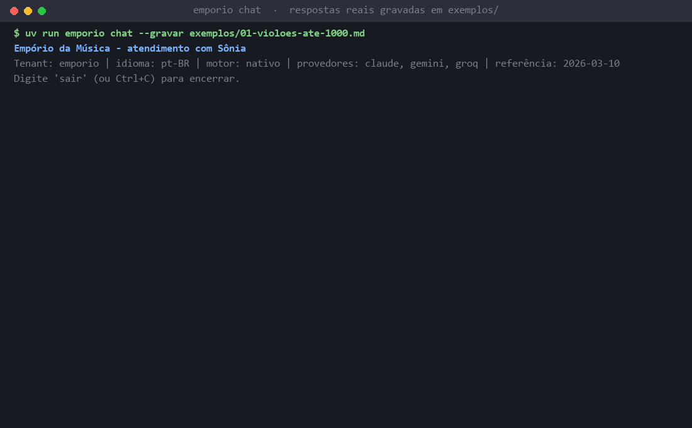
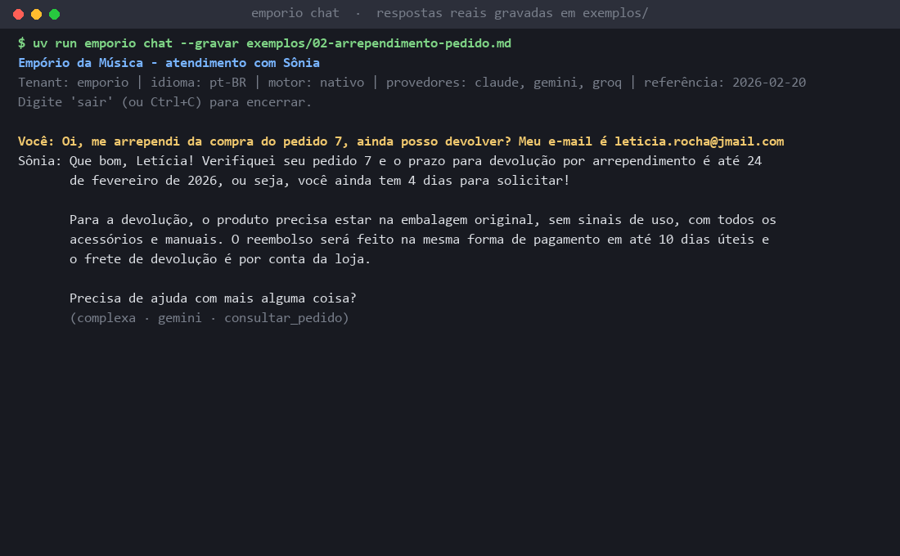
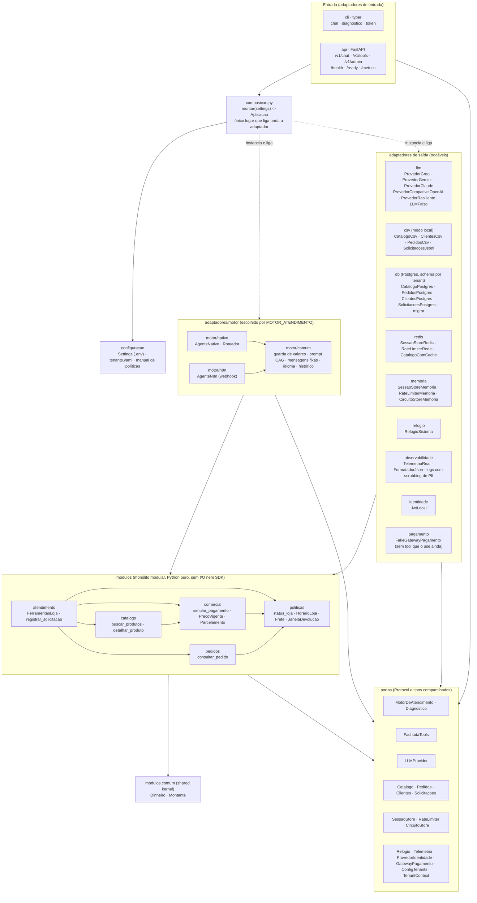

**Português (pt-BR)** · [English (en-US)](README.en-US.md)

# Empório da Música: agente de atendimento Sônia

> Processo: [board do projeto (3 epics, 9 stories, 29 tasks)](https://github.com/users/carlosbandelli/projects/4) · detalhes em [Como foi feito](#como-foi-feito-processo-e-board) · [diagramas da arquitetura](#arquitetura-em-diagramas).

Agente de atendimento por texto da **Empório da Música**, loja fictícia de instrumentos musicais em Campo Grande/MS.
A assistente se chama **Sônia**. Ela responde sobre preço, estoque, pedido, horário, endereço, parcelamento, devolução,
garantia e frete. Os dados vêm de ferramentas (CSVs ou Postgres) e as regras, do manual de políticas. A loja não vende
acessórios (cordas, palhetas, cabos, cases, pedais, amplificadores): a Sônia redireciona esses pedidos.

Desafio técnico Artefact, AI Engineer 2026.

O idioma padrão das respostas é o português do Brasil. O inglês funciona com `--idioma en-US` e com a detecção de
idioma (seção 4.10).

**Estado da entrega:** as Fases 1 (núcleo) e 2 (API, Postgres, Redis, observabilidade, RBAC, tools via HTTP, motor n8n,
Docker Compose e CI) estão implementadas. Ficaram de fora o gateway real de pagamento (só o simulado), o canal WhatsApp,
Grafana, Sentry e a execução do workflow n8n num n8n real. Veja a seção 8.

---

## Veja funcionando



*GIF desenhado a partir das conversas reais gravadas com LLM em [`exemplos/`](exemplos/README.md): violões até R$ 1000 (dados do catálogo e regra de parcelas) e, em inglês, preço do Takamine GD20, acessório fora de escopo e endereço. A linha cinza mostra `nível · provedor · tools`. Gerado por [`scripts/gerar_demo.py`](scripts/gerar_demo.py).*



*Print: "me arrependi, posso devolver?" com o pedido 7 verificado pelo e-mail e a janela de 7 dias do manual aplicada à data.*

## Arquitetura: multi-tenant, stateless, escalável e trocável

O projeto é um **monólito modular no meio, com arquitetura hexagonal (portas e adaptadores) nas bordas**. As regras de negócio ficam em Python puro, sem I/O nem SDK; tudo o que fala com o mundo de fora é um adaptador trocável atrás de uma porta. O `import-linter` (14 contratos, no CI) garante as dependências só para dentro.

| Propriedade | Como é garantida |
|---|---|
| **Multi-tenant** | Todo acesso a dado ou estado recebe um `TenantContext` (porta `portas/contexto.py`). Config por loja em `config/tenants.yaml` (persona, contatos, limites, manual). Postgres com **schema por tenant** (`search_path` por transação; conexão sem tenant não enxerga tabela). Chaves do Redis com prefixo do tenant. Na API, o tenant vem de `X-Tenant-ID` ou do subdomínio; o token JWT tem de ser do mesmo tenant. Invariantes I3 e I8 testados nos três motores. |
| **Stateless** | Com `DATABASE_URL` e `REDIS_URL`, o processo da aplicação não guarda conversa nem dado: sessão e rate limit no Redis, dados no Postgres; qualquer réplica atende qualquer mensagem. Sem estado global (regra da composição). Fica no processo, de propósito: circuit breaker e bulkhead por réplica, e a config editada pelo admin (#123). No modo local (sem Redis), a sessão fica na memória do processo (#21). |
| **Escalável** | `docker compose` sobe Traefik + **3 réplicas** + Postgres + Redis (verificado); o rate limit no Redis vale para todas as réplicas; manifestos Kubernetes com HPA 3–10 (exemplo, não exercitado). |
| **Trocável** | Cada dependência externa é uma porta com adaptadores escolhidos só em `composicao.py` por configuração (tabela abaixo). A suíte de contrato I1–I8 prova a troca do motor inteiro: passa igual para o nativo, pela API e para o n8n. |

**Onde está o monólito modular**: `src/emporio/modulos/` (regra de negócio, Python puro).

| Módulo | O que contém |
|---|---|
| `catalogo/` | produtos, categorias, busca, alternativas sem estoque, equivalentes de descontinuado |
| `comercial/` | preço vigente, PIX que não acumula com promoção, parcelamento por faixa, pagamento combinado |
| `pedidos/` | consulta de pedido com verificação por e-mail ou telefone |
| `politicas/` | horário e próxima abertura, frete, janelas de devolução, troca e garantia |
| `atendimento/` | solicitações (reclamação, cotação), status e a fachada das 6 tools |
| `comum/` | shared kernel (`Dinheiro` em centavos) |

Cada módulo tem `dominio.py` (regras) e `aplicacao.py` (casos de uso, a API pública do módulo). Um módulo nunca importa o `dominio` de outro (contrato C3).

**Onde está o hexagonal**: portas em `src/emporio/portas/`, adaptadores em `src/emporio/adaptadores/`.

| Porta (contrato) | Adaptadores | Lado |
|---|---|---|
| `MotorDeAtendimento` (`motor.py`) | `motor/nativo` (`AgenteNativo`), `motor/n8n` (`AgenteN8n`) | núcleo do agente |
| (entrada; chamam a porta acima) | `cli` (Typer), `api` (FastAPI) | **inbound** |
| `FachadaTools` (`ferramentas.py`) | fachada de `modulos/atendimento`, exposta em `/v1/tools` | inbound (tools por HTTP) |
| `LLMProvider` (`llm.py`) | `llm/`: Groq, Gemini, Claude, compatível com OpenAI (dinâmico), `LLMFalso` | **outbound** |
| `Catalogo`, `Pedidos`, `Clientes`, `Solicitacoes` (`repositorios.py`) | `csv/` (modo local), `db/` (Postgres por schema) | outbound |
| `SessaoStore`, `RateLimiter`, `CircuitoStore`, `Relogio` (`estado.py`) | `memoria/`, `redis/`, `relogio/` | outbound |
| `GatewayPagamento` (`pagamento.py`) | `pagamento/` (`FakeGatewayPagamento`) | outbound |
| `ProvedorIdentidade` (`identidade.py`) | `identidade/` (JWT local) | outbound |
| `Telemetria` (`telemetria.py`) | nula (padrão) e `observabilidade/` (Prometheus, OpenTelemetry) | outbound |

`composicao.py` é o **único** lugar que liga porta a adaptador. Trocar CSV por Postgres, memória por Redis, um LLM por outro ou o motor nativo pelo n8n é configuração (`DATABASE_URL`, `REDIS_URL`, chaves `*_API_KEY` ou `LLM_*`, `MOTOR_ATENDIMENTO`), sem mudar `modulos/`.

### Por que não LangChain ou LangGraph

1. **O LLM redige, o código calcula.** Preço, PIX, parcelas e prazos saem de funções testadas, e uma guarda revisa os valores da resposta antes de entregar. Num loop próprio (cerca de 350 linhas, [`motor/nativo/agente.py`](src/emporio/adaptadores/motor/nativo/agente.py)) esse controle é explícito; num framework ficaria espalhado em callbacks.
2. **Resiliência sob medida.** Roteamento por complexidade, circuit breaker por provedor (crédito esgotado abre o circuito), fallback entre provedores, deadline por mensagem e bulkhead. Com LangChain seria preciso contornar as abstrações dele.
3. **Troca de motor provada.** LangGraph acoplaria o núcleo ao framework. Aqui o motor é uma porta: um `AgenteLangGraph` entraria como mais um adaptador, sem mudar o núcleo, e teria de passar na mesma suíte I1–I8.
4. **Menos dependências e testes deterministas** (`LLMFalso`, sem rede). Detalhes na seção 4.2.

## Arquitetura em diagramas

Os diagramas são em **Mermaid**, que o GitHub desenha direto na página (abra os links abaixo no próprio GitHub). Foram feitos à mão a partir do código, e cada caixa foi conferida contra um módulo, arquivo ou serviço que existe. A ideia inicial era gerá-los com o [archify](https://github.com/tt-a1i/archify), mas isso exigiria instalar e executar código de terceiros; a decisão foi usar Mermaid, sem instalar nada.

Arquitetura em runtime (monólito modular no meio, hexagonal nas bordas; setas de dependência só para dentro, regras C1–C5):



| Diagrama | O que mostra |
|---|---|
| [01 · Arquitetura](docs/diagramas/01-arquitetura.md) | Camadas, portas e adapters, composition root e as regras C1–C5 do import-linter (o diagrama acima, com legenda). |
| [02 · Sequência de uma mensagem](docs/diagramas/02-sequencia-mensagem.md) | CLI/API → motor → rate limit e sessão → roteador → LLM com circuito, retry e fallback → tools → guarda de valores → resposta; tabela de degradação. |
| [03 · Modelo de dados (ERD)](docs/diagramas/03-erd.md) | Tabelas do schema de cada tenant no Postgres e suas relações. |
| [04 · Deploy e CI](docs/diagramas/04-deploy.md) | Traefik → 3 réplicas → Postgres/Redis, migração, Prometheus, n8n opcional; pipeline lint → mypy → testes → build no GHCR. |

## 1. Como rodar em 5 minutos

Você precisa de [git](https://git-scm.com/) e do [uv](https://docs.astral.sh/uv/). O uv instala o Python 3.12 sozinho.

| Caminho | Pré-requisitos | Comandos | O que mostra | Situação |
|---|---|---|---|---|
| **1. Rápido** (padrão) | git, uv e uma chave de LLM | `uv sync`, `.env`, `uv run emporio chat` | o agente completo, sobre os CSVs, sem Docker | funciona |
| **2. Completo** | + Docker | `docker compose up -d` | réplicas, Traefik, schema por tenant, rate limit, Prometheus | funciona (smoke executado) |
| **3. Sem rodar** | nenhum | ler `exemplos/`; `uv run pytest` | conversas gravadas; regras testadas com LLM simulado, sem chave | funciona |

### Caminho 1: passo a passo

**1. Instale o uv.**

Windows (PowerShell):

```powershell
powershell -ExecutionPolicy ByPass -c "irm https://astral.sh/uv/install.ps1 | iex"
```

macOS e Linux:

```bash
curl -LsSf https://astral.sh/uv/install.sh | sh
```

**2. Clone e instale as dependências** (Windows, macOS e Linux):

```bash
git clone https://github.com/carlosbandelli/emporio-da-musica-agente.git
cd emporio-da-musica-agente
uv sync
```

**3. Crie o arquivo de ambiente com uma chave.**

Windows (PowerShell):

```powershell
Copy-Item .env.example .env
```

macOS e Linux:

```bash
cp .env.example .env
```

Abra o `.env` e preencha **uma** chave. A recomendada é `GOOGLE_API_KEY` (Gemini, plano grátis), obtida em
<https://aistudio.google.com/api-keys>. As outras (`GROQ_API_KEY`, `ANTHROPIC_API_KEY`) são opcionais. Chaves vazias
são ignoradas. Também dá para usar OpenAI, DeepSeek, OpenRouter, Ollama e outros (ver "Usar outro provedor" abaixo).

**4. Confira a configuração e converse.**

```bash
uv run emporio diagnostico
uv run emporio chat
```

- `diagnostico` mostra quais provedores têm chave (só os nomes), o motor, o tenant, os dados carregados, o manual, a
  data de referência e a configuração de Postgres e Redis. Nunca mostra valores de chave.
- `chat` abre a conversa. Digite `sair` (ou Ctrl+C) para encerrar.

**Opcional:**

- Simular a data de "hoje". Os pedidos do CSV vão até março de 2026, então, sem isso, o agente usa a data real. Para
  simular, descomente no `.env`: `DATA_REFERENCIA=2026-03-10T15:00:00-04:00`.
- Conversar em inglês: `uv run emporio chat --idioma en-US`.
- Gravar a conversa em Markdown: `uv run emporio chat --gravar minha-conversa.md`.
- Conversar com a API em vez do motor local: `uv run emporio chat --api http://localhost:8000` (ver "Notas").

### Usar outro provedor (OpenAI, DeepSeek, OpenRouter, Ollama...)

Qualquer API compatível com a Chat Completions da OpenAI (com tool calling) entra só pelo `.env`, sem mudar código.
Basta nome, modelo e chave:

```dotenv
LLM_PROVEDOR=deepseek        # nome livre: aparece nos logs, nas métricas e no diagnóstico
LLM_MODELO=deepseek-chat     # obrigatório quando há chave
LLM_API_KEY=sk-...           # Ollama local não exige chave: use qualquer valor (ex.: ollama)
# LLM_BASE_URL=              # opcional; vazio = URL pronta do nome
```

- Nomes com URL pronta: `openai` (padrão), `deepseek`, `openrouter`, `mistral`, `together` e `ollama`
  (`http://localhost:11434/v1`; no Docker, use `LLM_BASE_URL=http://host.docker.internal:11434/v1`). Qualquer outro
  nome (vLLM, LM Studio, Gemini pelo endpoint OpenAI...) exige `LLM_BASE_URL`. O nome não pode ser `claude`, `gemini`
  nem `groq`, que já são nativos (use, por exemplo, `gemini-openai`).
- **Na cadeia:** com outras chaves, ele entra no fim de todas as cadeias de fallback (seção 4.3). Sozinho, atende todos
  os níveis e o classificador não é chamado.
- `uv run emporio diagnostico` mostra o nome, o modelo e o endpoint, nunca a chave. Configuração inválida (chave sem
  modelo, nome desconhecido sem URL) encerra com mensagem clara.
- O `.env.example` traz exemplos comentados para OpenAI, DeepSeek, OpenRouter e Ollama.

### Sem nenhuma chave

- `uv run pytest` roda todos os testes sem chave. Os testes que chamam LLM real ficam pulados.
- `uv run emporio chat` encerra com código de saída 2 e uma mensagem dizendo o que falta, sem stack trace.

### Notas

- Rode os comandos na raiz do repositório. O `.env` e a pasta `config/` são lidos a partir da pasta atual.
- **API.** Sobe local, sem Docker:
  `uv run uvicorn emporio.adaptadores.api.app:app --port 8000`.
  - `POST /v1/chat`: uma mensagem do cliente. O tenant vem do header `X-Tenant-ID` ou do subdomínio do `Host`.
    `Accept-Language` escolhe pt-BR ou en-US. Com limite de uso estourado, responde 429 com `Retry-After`.
  - `GET /health` (liveness) e `GET /ready` (503 sem chave de LLM).
  - `GET /metrics` (porta 8000; o Ingress não expõe).
  - `GET /v1/tools` e `POST /v1/tools/{nome}` (permissão `tools:usar`), e `/v1/admin/...` (RBAC, seção 4.11).
  - Sem chave de LLM, a API sobe, mas `/ready` e `/v1/chat` devolvem 503.
- **Postgres e Redis (opcionais).** Sem `DATABASE_URL` e `REDIS_URL`, o estado fica em memória do processo. Com elas:
  - `DATABASE_URL` liga o Postgres, com um schema por tenant. Antes de subir a API ou o `chat`, rode a migração
    com seed dos CSV: `uv run python -m emporio.adaptadores.db.migrar`.
  - `REDIS_URL` liga o Redis para sessão, rate limit e cache do catálogo.
- **Token para a API com RBAC.** `uv run emporio token --tenant emporio --papel gerente` imprime um JWT. Exige
  `JWT_SECRET` com pelo menos 32 bytes no `.env`. Papéis: `cliente`, `atendente`, `gerente` e `admin_plataforma`.

### Caminho 2: Docker (Traefik, 3 réplicas, Postgres, Redis, Prometheus)

Pré-requisito: Docker com Compose v2 e o arquivo `.env` com ao menos uma chave de LLM (o compose o lê por `env_file`).

```bash
docker compose up -d --build        # migração (serviço "migrate") -> 3 réplicas da app -> Traefik
docker compose ps                   # app x3 healthy, postgres, redis, traefik, prometheus
curl localhost/health
curl localhost/ready
curl -X POST localhost/v1/chat -H "X-Tenant-ID: emporio" -H "Content-Type: application/json" \
  -d '{"session_id":"demo-1","mensagem":"Ola, qual o horario de funcionamento da loja?"}'
docker compose down -v              # derruba e apaga os volumes
```

Smoke executado (Docker Engine 29, Windows 11): `migrate` terminou com código 0; as 3 réplicas ficaram `healthy`;
`/health` e `/ready` via Traefik responderam 200 (10 chamadas a `/ready` caíram nas 3 réplicas); `/metrics` não passa pela
borda (404) e o Prometheus raspou os 4 alvos (3 réplicas e o Traefik); uma chamada a `POST /v1/chat` respondeu 200
(nível `simples`, provedor `gemini`, tool `status_loja`). Variáveis úteis: `APP_REPLICAS` (padrão 3) e
`POSTGRES_PASSWORD`.

Observações do caminho 2:

- O Traefik é v3.6 porque as versões anteriores não falam com o Docker Engine 29 (API mínima 1.44).
- No Windows, se o caminho do repositório tiver acentos (como `Técnico`), o BuildKit falha com `x-docker-expose-session-sharedkey
  contains value with non-printable ASCII characters`. Clone para um caminho só com ASCII, ou construa a imagem de uma cópia
  ASCII (`docker build --target runtime -t emporio:local .`) e suba com `docker compose up -d --no-build`.
- Grafana e Sentry ficaram para o futuro. O Sentry agruparia exceções com stack trace e contexto, alertaria regressões e
  rastrearia releases. O Grafana montaria painéis sobre as métricas Prometheus (latência p95 por provedor, taxa de
  fallback/degradação, circuito aberto, tokens e custo por tenant) e alertas. O dashboard de partida está em
  `deploy/observabilidade/grafana/` (sem serviço no compose). OTel Collector, Loki e Alloy seguem como perfil opcional
  (`--profile observabilidade`, com `OTEL_EXPORTER_OTLP_ENDPOINT=http://otel-collector:4318`).
- CI (`.github/workflows/ci-cd.yml`): lint (ruff e import-linter), tipos (mypy) e testes (pytest, com Postgres e Redis
  como serviços do Actions) em cadeia, depois build da imagem no GHCR. Scan e deploy em Kubernetes são exemplo: o deploy
  só roda com a variável de repositório `DEPLOY_ENABLED=true` e o secret `KUBECONFIG_PRODUCAO`; não há cluster nesta entrega.

---

## 2. Comandos

| Comando | O que faz |
|---|---|
| `uv run emporio --help` | lista os comandos |
| `uv run emporio versao` | mostra a versão instalada |
| `uv run emporio chat [--tenant ID] [--idioma pt-BR ou en-US] [--gravar ARQUIVO.md]` | conversa no terminal, no mesmo processo |
| `uv run emporio chat --api http://localhost:8000 [--tenant ID]` | mesma conversa, mas cada mensagem vai para `POST /v1/chat` da API |
| `uv run emporio diagnostico [--tenant ID]` | estado da configuração; não mostra chaves |
| `uv run emporio token --tenant ID --papel PAPEL [--sub ID] [--expira-em S]` | emite um JWT local (precisa de `JWT_SECRET`); imprime só o token |
| `uv run python -m emporio.adaptadores.db.migrar` | migra e semeia o Postgres por tenant (precisa de `DATABASE_URL`) |
| `uv run uvicorn emporio.adaptadores.api.app:app --port 8000` | sobe a API |
| `uv run pytest` | testes (sem chave; os `llm_real` ficam pulados) |
| `uv run pytest --cov=src/emporio -q` | testes com cobertura |
| `uv run lint-imports` | dependências: regras C1 a C5 (14 contratos) |
| `uv run ruff check . && uv run ruff format --check .` | lint e formatação |
| `uv run mypy src` | checagem de tipos (strict em `src/`) |
| `EMPORIO_LLM_REAL=1 uv run pytest tests/e2e/test_llm_real.py -v` | testes com LLM real (precisa de chave e gasta cota) |

No PowerShell, o teste com LLM real fica: `$env:EMPORIO_LLM_REAL=1; uv run pytest tests/e2e/test_llm_real.py -v`.

---

## 3. Estrutura do repositório

```
src/emporio/
  modulos/        regras de negócio puras, sem I/O nem SDK: catalogo, comercial, pedidos, politicas, atendimento, comum
  portas/         contratos (Protocol) e tipos compartilhados: motor, LLM, repositórios, estado, identidade, pagamento...
  adaptadores/    cli, api, motor (nativo, n8n, comum), llm (groq, gemini, claude, falso), csv, memoria, redis, db,
                  identidade, observabilidade, pagamento, relogio
  configuracao/   Settings (lê o .env) e carregamento de tenants
  composicao.py   único lugar que liga portas a adaptadores
config/           tenants.yaml e o manual de políticas em Markdown (config/tenants/emporio/politicas.md)
data/             CSVs da loja e o PDF original do manual
docs/             arquitetura, premissas, pagamento (desenho), deploy e diagramas
deploy/           Docker (Traefik, Prometheus, Grafana de partida), n8n (workflow de exemplo) e Kubernetes (exemplo)
exemplos/         3 conversas gravadas com LLM real
tests/            unitários, contrato (I1 a I8 e pagamento) e ponta a ponta (e2e)
```

### Diagramas

Diagramas em Mermaid, em [docs/diagramas/](docs/diagramas/README.md) (visão geral na seção [Arquitetura em diagramas](#arquitetura-em-diagramas)):

- [01-arquitetura.md](docs/diagramas/01-arquitetura.md): componentes e camadas.
- [02-sequencia-mensagem.md](docs/diagramas/02-sequencia-mensagem.md): o caminho de uma mensagem.
- [03-erd.md](docs/diagramas/03-erd.md): tabelas do schema por tenant.
- [04-deploy.md](docs/diagramas/04-deploy.md): implantação.

---

## 4. Decisões técnicas e justificativas

### 4.1 Linguagem, ambiente e dependências

- **Python 3.12** (`.python-version`) e **uv** com `uv.lock`. O enunciado só exige Python. O uv instala o interpretador e
  resolve as dependências do mesmo jeito em Windows, macOS e Linux.
- O projeto declara 25 dependências de runtime. A Fase 1 usava 11: os SDKs de Groq, Gemini e Anthropic, `tenacity`
  (retry), `pydantic` e `pydantic-settings`, `typer` (CLI), `babel` e `holidays` (datas e feriados), `pyyaml` e `tzdata`.
  A Fase 2 acrescentou FastAPI e uvicorn (API), SQLAlchemy, psycopg e Alembic (Postgres), `redis`, PyJWT, `httpx`
  (cliente da CLI remota), `prometheus-client` e OpenTelemetry (opcional). Depois vieram o SDK `openai` e o `httpx2`
  (cliente HTTP dele), para o provedor compatível com a API da OpenAI.
- Sentry não é dependência nem é usado (premissa #106); `SENTRY_DSN` em `Settings` fica reservado para a melhoria futura.

### 4.2 Framework do agente: loop próprio, sem LangChain ou LangGraph

Escrevi o loop agentic (roteia, chama o LLM, executa tools, repete) em vez de usar um framework.

- **Controle do loop.** O limite de 6 chamadas ao LLM por mensagem, o deadline de 30 s, a guarda de valores monetários
  e a troca de provedor precisam acontecer em pontos exatos do fluxo. Num framework, cada um viraria um gancho a adaptar.
- **Resiliência específica.** Retry com backoff e jitter, circuit breaker e bulkhead por provedor (arquitetura §5.2)
  são lógica própria. Uma biblioteca genérica exigiria a mesma adaptação.
- **Tools testáveis.** As tools são casos de uso Python puros (`modulos/*/aplicacao.py`). O motor só as chama, e os
  testes as executam sem LLM.
- **Custo.** O loop do motor nativo (`adaptadores/motor/nativo/agente.py`) tem cerca de 350 linhas, e o projeto o
  mantém sem depender de nenhum orquestrador externo. Em troca, não há grafos nem memória prontos, como num framework.
  Se o fluxo virar vários agentes cooperando, esta decisão deve ser reavaliada.
- **Fase 2.** O motor `n8n` executa o workflow no n8n, mas a decisão continua no Python: validação, histórico, guarda e
  mensagens fixas ficam no código (premissa #160). O n8n só orquestra as chamadas de tool.

### 4.3 LLM: três provedores nativos (mais um compatível com OpenAI), roteados por complexidade

| Nível | Exemplos | Provedor e modelo padrão | Motivo |
|---|---|---|---|
| simples | saudação, horário, endereço, fora de escopo | Groq `openai/gpt-oss-120b` (raciocínio `low`) | latência baixa e tool calling |
| média | busca de produto, preço, status de pedido | Gemini `gemini-2.5-flash` | plano grátis; respondeu em 0,8 s no teste de 2026-11-01 |
| complexa | parcelas, troca, devolução, garantia, frete, reclamação | Claude `claude-opus-5-5` (esforço `low`) | regras com exceções, onde errar custa caro |

- **Classificador.** Uma chamada curta ao Groq, sem tools, com no máximo 5 s. Recebe a mensagem e as três últimas falas
  da conversa, para entender respostas curtas como "e em 10x?". **Na dúvida, sobe de nível.** Sem Groq, usa Gemini e
  depois Claude. Se a classificação falha, vai para `complexa`. Se todos os níveis têm a mesma cadeia (uma só chave),
  o classificador nem é chamado (premissas #48 e #50).
- **Fallback.** Cadeias, filtradas pelas chaves presentes (premissa #49):

  | Nível | Ordem |
  |---|---|
  | complexa | Claude → Gemini → Groq |
  | média | Gemini → Claude → Groq |
  | simples | Groq → Gemini → Claude |

  O provedor compatível com OpenAI (`LLM_PROVEDOR`, seção 1) entra no fim das três cadeias e por último na fila do
  classificador. É um adaptador genérico (`adaptadores/llm/compativel_openai.py`, SDK oficial `openai`) que só troca
  URL base, modelo e chave: Chat Completions com tools, a mesma conversão de mensagens e de tool calls do Groq, uso de
  tokens sem o cache e a mesma classificação de erros (401/403 autenticação; 402 e `insufficient_quota` sem crédito;
  429 com `Retry-After`, 5xx, timeout e conexão transitórios; 400/404/422 permanentes).

- **Resiliência por provedor** (arquitetura §5.2):
  - Até 3 tentativas, só para erros transitórios (timeout, conexão, 429, 5xx), com backoff exponencial e full jitter.
    Os retries internos dos SDKs ficam desligados.
  - Circuit breaker: abre após 5 falhas transitórias seguidas ou 50% de falhas em 30 s (mínimo de 10 chamadas).
    Autenticação inválida (401/403) e crédito ou cota esgotados abrem na hora (premissa #53). Depois, uma única sonda
    testa a volta do provedor.
  - Bulkhead: no máximo 5 chamadas simultâneas ao Claude e 10 ao Gemini, ao Groq e ao provedor compatível com OpenAI.
- **Modelos e erros conhecidos.**
  - `gemini-flash-latest` respondeu com 504 em chamada real. Por isso o padrão é `gemini-2.5-flash` (premissa #43).
  - O plano grátis do Groq tem 8 mil tokens por minuto. Cada turno com tool gasta cerca de 6 mil tokens de entrada,
    então só com a chave Groq um turno pode estourar o limite e sair degradado (premissa #67).
  - A conta Anthropic usada no desenvolvimento estava sem crédito em 2026-11-01. Por isso, os exemplos foram gravados
    com Gemini e Groq, e o nível complexo caiu para Gemini pelo fallback (premissa #66). O adaptador do Claude tem
    testes com fakes HTTP, mas nenhuma chamada real validada. A chave usada no desenvolvimento expira por volta de
    2026-11-07.

### 4.4 Recuperação: CAG, não RAG

Cada tipo de conhecimento usa a técnica que dá resposta exata:

| Conhecimento | Técnica | Como |
|---|---|---|
| Dados: estoque, preço, promoções, pedidos | tools (function calling) | consulta estruturada exata nos CSVs (ou no Postgres); o LLM não lê preço de texto |
| Políticas: manual de 8 páginas (v2.1) | CAG (cache-augmented generation) | o manual inteiro vai no system prompt, no bloco cacheável |
| Regras com cálculo: PIX, parcelas, frete, prazos, horário | código Python (`modulos/*/dominio.py`) | "o LLM decide e redige; o código calcula" |

Por que não RAG vetorial:

- Um vetor não filtra preço nem estoque. Para isso servem as tools.
- Os chunks separam regras relacionadas. A regra do PIX aparece em §3 e §6.2 do manual; um chunk pode trazer uma e
  perder a outra.
- O manual cabe no contexto. Não há ganho de recuperar só parte dele.
- Graph RAG e REFRAG também foram avaliados e descartados (arquitetura §1).

O manual é convertido do PDF para `config/tenants/emporio/politicas.md` uma vez, revisado à mão contra o original, e
versionado (premissa #20). O PDF em `data/` é a origem e não é lido em tempo de execução.

Custo: cada chamada leva cerca de 6 mil tokens de entrada, com o manual. O bloco cacheável é idêntico byte a byte entre
sessões, idiomas e datas (premissa #42), para o prompt caching do provedor funcionar. **Não medi a taxa de acerto do
cache:** a métrica para isso (`emporio_prompt_cache_total`) existe desde a Fase 2, mas ainda não há medição publicada.

### 4.5 Estratégia de prompt

- **Persona Sônia** (arquitetura §9.2, a partir do manual §7.1 e §7.2): informal, mas profissional, como uma amiga que
  entende de música. Resposta primeiro, 2 a 5 frases, no máximo um emoji e nenhum em reclamação. Se apresenta como
  assistente virtual e não finge ser humana.
- **Prompt em dois blocos** (premissa #42):
  - bloco cacheável: persona, regras em pt-BR e en-US e o manual completo. Depende só do tenant;
  - bloco dinâmico: idioma da sessão e data de referência em granularidade de dia, nunca a hora.
  - "A loja está aberta agora?" e "quando reabre?" são sempre respondidos pela tool `status_loja`, não pelo modelo.
- **O LLM redige, o código calcula.** Preço, parcela, frete e prazo vêm das tools. O LLM escreve a resposta em torno deles.
- **Nunca afirmar sem tool.** Preço, estoque e status de pedido só aparecem no texto se a tool correspondente foi
  chamada (invariante I6 da porta, arquitetura §3.2).
- **Guarda de valores monetários** (premissa #58). Todo `R$` da resposta final tem que vir de um resultado de tool da
  sessão, de uma fala do cliente ou do manual. Se não, há uma rodada corretiva. Se o modelo insistir, a resposta sai
  com a mensagem fixa, sem o valor.
- **Tools por papel.** As seis tools (`buscar_produtos`, `detalhar_produto`, `simular_pagamento`, `consultar_pedido`,
  `status_loja` e `registrar_solicitacao`) valem para todos os papéis. O filtro por papel já é aplicado em `GET /v1/tools`,
  mas ainda não há tool exclusiva de atendente ou gerente.
- **Mensagens fixas** (erro, limite de uso, loja fechada, deadline) vêm de um catálogo de traduções, não do LLM. Assim
  funcionam mesmo com todos os provedores fora.

### 4.6 Arquitetura: monólito modular e hexagonal só nas bordas

- **Monólito modular.** Um pacote por contexto (`catalogo`, `comercial`, `pedidos`, `politicas`, `atendimento`) e o
  shared kernel `comum` (`Dinheiro`). Cada pacote tem `dominio.py` (regras) e `aplicacao.py` (casos de uso, a API
  pública do módulo).
- **Hexagonal só onde há troca real.** Portas para o motor de atendimento, os provedores de LLM, os repositórios, o
  estado (sessão, rate limit, circuito), o relógio, a identidade, a telemetria e o gateway de pagamento. Trocar um deles
  muda só o adapter.
- **Composition root.** `composicao.py` é o único lugar que instancia adapters e lê o `Settings`. Não há singletons,
  `global` nem cache em variável de módulo.
- **Regras de dependência C1 a C5**, verificadas pelo import-linter (`uv run lint-imports`, 14 contratos). Uma exceção,
  registrada: a CLI pode importar a composição (premissa #65). A API e a CLI não importam adapters (C4); o pagamento
  segue a mesma regra (premissa #166).
- **Contrato da porta `MotorDeAtendimento`** (arquitetura §3.2): `responder(ctx, sessao_id, mensagem)`. A suíte
  `tests/contrato` testa os invariantes I1 a I8 para cada motor registrado: `nativo`, `api` e `n8n`. Um motor novo só
  entra se passar nela. A suíte `tests/contrato/pagamento` faz o mesmo com o `GatewayPagamento`.

### 4.7 Interface: CLI e API

- O enunciado pede um agente de atendimento por texto, e não uma interface gráfica. A CLI roda sem servidor, sem Docker
  e sem navegador. Ela chama o motor pela mesma porta que a API usa.
- A opção `--gravar` salva a conversa em Markdown, turno a turno. Foi assim que os exemplos foram gerados.
- A API (FastAPI) é a mesma porta para o `chat --api`, para o motor n8n e para as tools via HTTP. Um frontend web não
  foi pedido e não entrou no plano.
- Trade-off: não há histórico visual e não há canal real (WhatsApp).

### 4.8 Histórico e sessão

- **Fase 1:** histórico em memória, por processo. Ele some ao sair do `chat` (premissa #21). A sessão expira em 30 min
  sem mensagens (premissa #60).
- **Append-only.** O histórico não é editado. Isso preserva o prefixo do prompt cacheado e os blocos de raciocínio que
  o Claude (`thinking`) e o Gemini (`thought_signature`) exigem de volta. Editar o histórico quebra o cache e pode gerar
  erro 400 (premissa #47).
- **Corte.** Acima de 40 mensagens, saem os turnos inteiros mais antigos. Nunca fica um `tool_use` sem o `tool_result`
  correspondente: se o turno falha no meio, a sessão guarda só a mensagem do cliente e a resposta fixa.
- **Fase 2 (com `REDIS_URL`):** a sessão fica no Redis, com TTL, e vale para todas as réplicas. Se o Redis cai, a sessão
  não é gravada e a conversa segue sem histórico (fail-open). O rate limit usa um bucket local de emergência, e o cache
  do catálogo é ignorado. Um timeout de 300 ms e uma pausa de 5 s impedem que cada chamada espere pelo Redis parado
  (arquitetura §5.2).

### 4.9 Limpeza de dados

Os CSVs têm problemas reais, e cada um tem um tratamento documentado:

| Problema | Tratamento | Premissa |
|---|---|---|
| `total_brl` ora em reais (`799.9`), ora parece em centavos (`11499`) | reais, com casas opcionais; convertido para centavos inteiros com `ROUND_HALF_UP` | #22 |
| `specs` com JSON inválido (não há casos atuais) | produto mantido com `specs` vazias e aviso com linha e id | #23 |
| linha com id, preço, categoria, estoque negativo ou status desconhecido | linha descartada com aviso (arquivo e número da linha, sem dados pessoais) | #24 |
| `payment_method`: `credit_Nx`, `debit`, `pix`, `boleto` | enum; `credit_Nx` vira crédito em N parcelas | #25 |
| `tracking_code` e `estimated_delivery` vazios em pedidos sem envio | `None`; não se presume que só pedido `shipped` tenha rastreio | #25 |
| várias linhas de promoção por produto; algumas inativas | só `is_active=1` aplica; promoções não acumulam, vale a maior | #26, #28 |
| categorias 6 a 8 sem produtos | mantidas; a resposta diz que não há itens no momento, sem afirmar que a loja não vende | #9, #26 |
| produto `discontinued` ou `coming_soon` | fora da busca padrão; quando consultado, oferece equivalentes | #26 |
| id de produto duplicado | vale a primeira ocorrência | #24 |
| pedido `delivered` sem data real de recebimento | usa `estimated_delivery` como substituto e diz isso na resposta | #6 |

`customers.csv` tem dados pessoais. Por isso, `consultar_pedido` exige número do pedido **e** e-mail ou telefone, e
uma falha de verificação devolve sempre a mesma resposta genérica, sem revelar nada do pedido (premissas #15 e #40).

Com `DATABASE_URL`, o seed do Postgres usa os mesmos CSV e o mesmo tratamento. As tabelas são `categorias`, `produtos`,
`promocoes`, `clientes`, `pedidos`, `itens_pedido` e `solicitacoes`, em um schema por tenant.

### 4.10 Idioma e persona

- O idioma é detectado, não perguntado: heurística por palavras em português e inglês. Quando a mensagem é ambígua,
  vale o idioma do canal (`--idioma`, padrão do tenant). Um pedido explícito, como "can we speak English?", troca o
  idioma a qualquer momento (premissa #57).
- Os valores são sempre em reais (BRL), formatados conforme o idioma da sessão.
- A persona é a mesma nos dois idiomas. O manual não é traduzido: o LLM lê as regras em português e responde no idioma
  da sessão.

### 4.11 Fase 2: persistência, API, identidade e observabilidade

| Tema | Decisão | Motivo |
|---|---|---|
| Persistência | Postgres com um schema por tenant (`DATABASE_URL`), SQLAlchemy e Alembic por schema | isolamento por tenant sem duplicar código. Conexão sem tenant não enxerga tabelas de loja |
| Migrações | `migrar` roda Alembic em cada schema, sob advisory lock do Postgres | réplicas ou processos concorrentes não migram ao mesmo tempo |
| Estado compartilhado | Redis: sessão com TTL, rate limit em Lua, cache do catálogo sem estoque | o estado vale para todas as réplicas; o script Lua roda atômico no servidor |
| API | FastAPI; tenant por header ou subdomínio; 429 com `Retry-After` | ponto de entrada único para a CLI remota, o n8n e as tools HTTP |
| Identidade | JWT local, assinado com `JWT_SECRET`; papéis mapeados a permissões; `/v1/admin/solicitacoes` e `/v1/admin/config` | sem provedor de identidade externo no desafio; a porta `ProvedorIdentidade` recebe um IdP depois |
| Observabilidade | métricas Prometheus do contrato (`docs/deploy.md` §6), OpenTelemetry opcional, logs JSON com PII mascarada | o contrato de métricas é o que um Grafana consumiria |
| Pagamento | porta `GatewayPagamento` e `FakeGatewayPagamento`, com suíte de contrato | troca por gateway real sem mudar o chat (premissa #166) |
| Motor n8n | `MOTOR_ATENDIMENTO=n8n`, webhook; o Python mantém validação, guarda e histórico | o n8n orquestra; as regras continuam testadas no Python (premissas #160 e #164) |

---

## 5. Premissas (ambiguidades do enunciado)

O enunciado pede que, em caso de ambiguidade, seja assumida uma interpretação razoável e documentada. São 166
premissas, com a decisão e o motivo de cada uma, em [docs/premissas.md](docs/premissas.md). A regra geral é: a regra mais
específica vence, e na dúvida o agente não inventa, encaminha para a equipe.

Algumas das mais visíveis:

| # | Ambiguidade | Decisão |
|---|---|---|
| 1 | Telefone diferente na capa (3341-4444) e na §7 (WhatsApp 3321-4500) | informa os dois: telefone e WhatsApp |
| 2 | E-mail com e sem acento | `contato@emporiodamusica.com.br`, sem acento |
| 4 | Parcela mínima "R$ 100" na tabela × faixas na §3.1 | vale a §3.1: até 3x com mínimo de R$ 50 por parcela; 4 a 6x, R$ 80; 7 a 12x, R$ 100 |
| 5 | Defeito em 30 dias × garantia legal de 90 dias | até 30 dias da compra, troca na loja; até 90 dias do recebimento, garantia legal com a loja intermediando |
| 7 | Arrependimento vale só para compra online | todos os pedidos são tratados como online (têm entrega e rastreio) |
| 11 | Frete fora de Campo Grande depende de CEP, peso e dimensões | informa modalidades e prazos, não informa valor, e registra cotação para a equipe |
| 12 | "Região metropolitana" sem lista de cidades | só Campo Grande; a partir de R$ 500 o frete é grátis |
| 15 | Consulta de pedido e LGPD | número do pedido e e-mail ou telefone; sem correspondência, nenhum dado do pedido |
| 19 | Avaliador roda sem nenhuma chave | `diagnostico` explica, `chat` sai com código 2, `pytest` roda |
| 22 | `total_brl` em reais ou centavos | reais (`11499` = R$ 11.499,00) |
| 28 | Duas promoções ativas no mesmo produto | não acumulam: vale a de maior percentual |
| 29 | Arredondamento do desconto | calculado uma vez, em centavos, `ROUND_HALF_UP` (R$ 99,90 no PIX = R$ 94,91) |
| 31 | Pagamento combinado | só acima de R$ 2.000,00 (R$ 2.000,00 não combina); sem desconto PIX dentro do combinado |
| 36 | Contagem de prazos de devolução | o dia de referência é o dia 0 (recebimento; para defeito, a compra); o 7º dia ainda vale, o 8º não |
| 58 | Valor monetário não verificado na resposta | rodada corretiva; se insistir, mensagem sem o valor |
| 106 | Sentry e Grafana | fora da entrega por decisão do usuário; ficam como melhoria futura |
| 166 | Pagamento | porta e fake em hexagonal; sem gateway real |

---

## 6. Qualidade e testes

- **Testes:** `uv run pytest -q` dá 1287 passados e 3 pulados (os `llm_real`, sem chave).
- **Cobertura** de `src/emporio`: 98%.
- **Gate estático:** ruff (lint e formatação), mypy em modo strict em `src/`, e import-linter com 14 contratos (C1 a C5).
- **Quatro camadas de teste:**
  - unitários por módulo e adapter, com `LLMFalso` (respostas roteirizadas) e CSVs reais;
  - contrato da porta `MotorDeAtendimento` (I1 a I8), parametrizado pelos motores `nativo`, `api` e `n8n`
    (`tests/contrato`), e contrato do `GatewayPagamento` (`tests/contrato/pagamento`);
  - ponta a ponta (`tests/e2e/test_cenarios.py`): cenários do enunciado e das regras, com CSV real e LLM roteirizado. Um
    deles é o "violões até R$ 1.000", outro o "me arrependi, posso devolver?", com o pedido verificado;
  - integração com Postgres e Redis reais no CI (serviços do GitHub Actions).
- **Testes com LLM real** ficam em `tests/e2e/test_llm_real.py`, marcados `llm_real`. Só rodam com `EMPORIO_LLM_REAL=1` e
  uma chave. Chamadas reais mínimas mostraram dois problemas que os fakes não pegavam: o alias `gemini-flash-latest`
  (504) e o limite de tokens por minuto do Groq.

---

## 7. Conversas de exemplo

Três conversas gravadas com LLM real, pelo próprio `emporio chat --gravar`, com a data de referência no cabeçalho. Cada
resposta traz a linha `nível · provedor · tools chamadas`. Detalhes em [exemplos/README.md](exemplos/README.md).

| Arquivo | Cenário | O que mostra |
|---|---|---|
| [01-violoes-ate-1000.md](exemplos/01-violoes-ate-1000.md) | "violões até R$1000" e parcelamento | busca no catálogo e simulação de pagamento com a regra de parcela mínima |
| [02-arrependimento-pedido.md](exemplos/02-arrependimento-pedido.md) | "me arrependi da compra, posso devolver?" | pedido real verificado por e-mail e janela de 7 dias do manual aplicada à data |
| [03-english-takamine-strings.md](exemplos/03-english-takamine-strings.md) | em inglês: Takamine GD20, cordas e endereço | preço, PIX e 12x em formato en-US; acessório fora de escopo; endereço do manual |

Os valores citados batem com os CSVs, e a lógica deles está coberta por testes em `tests/e2e` (detalhes em
[exemplos/README.md](exemplos/README.md)). Limitação vista na gravação: no exemplo 01, a resposta à segunda pergunta trouxe
o parcelamento, mas omitiu o PIX que o cliente tinha pedido. As gravações são da Fase 1 e não foram refeitas na Fase 2.

---

## 8. Limitações e próximos passos

### 8.1 Fora da entrega

Implementado na Fase 2: os itens da seção 4.11, o `docker-compose.yml` com Traefik, três réplicas, Postgres, Redis e
Prometheus (seção 1, caminho 2), e o CI. Ficaram de fora:

- **Gateway real de pagamento.** Só existe o `FakeGatewayPagamento`, que marca toda cobrança como simulação. O desenho
  está em `docs/pagamento.md`.
- **Canal WhatsApp.** A API é o ponto de entrada; não há webhook do WhatsApp.
- **Grafana e Sentry.** Não estão no compose. O dashboard de partida fica em `deploy/observabilidade/grafana/`, sem
  serviço. Ver seção 8.3.
- **OTel Collector, Loki e Alloy.** Perfil opcional do compose, não ativado por padrão.
- **Kubernetes.** Os manifests em `deploy/k8s/` são exemplo e não foram exercitados. O deploy da pipeline só roda com
  `DEPLOY_ENABLED=true`, e não há cluster nesta entrega.
- **Workflow n8n.** `deploy/n8n/workflow-atendimento.json` não foi executado num n8n real (premissa #164).

### 8.2 Limitações conhecidas

- **Cliente que escreve palavra por palavra** (premissa #177): cada mensagem vira um turno completo. Fragmentos como "oi", "quero", "um violão" geram uma resposta cada (mais chamadas de LLM e custo), podem esbarrar no rate limit da sessão (rajada de 10, depois 1 a cada 5 s) e, pela API, dois fragmentos simultâneos podem perder um turno (#167). O histórico mantém o contexto, então a resposta ao último fragmento enxerga a frase inteira.
- **Achados da revisão final aceitos** (premissa #167): rate limit só nas camadas `sessao` e `tenant` (as camadas `usuario` e `provedor` estão configuradas mas não aplicadas); duas mensagens simultâneas na mesma sessão podem perder um turno; cache de promoções no Redis pode ficar até 60 s desatualizado; sonda do circuito presa por 30 s se o prazo da mensagem estourar durante ela.
- **Modo local.** Sem `DATABASE_URL` e `REDIS_URL`, sessão, rate limit e circuito ficam em memória, por processo. O
  histórico some ao sair do `chat`.
- **Redis fora.** A conversa segue sem histórico (fail-open, seção 4.8). Nenhuma chamada falha por causa do Redis.
- **Configuração editada só em memória** (premissa #123). `PUT /v1/admin/config` muda a configuração do processo: some
  ao reiniciar e não chega às outras réplicas.
- **Build Docker com acento no caminho** (premissa #135). Ver seção 1, caminho 2.
- **Guarda só verifica valores monetários** (premissa #58). Estoque e status de pedido dependem da instrução no prompt
  e do uso da tool, não de uma verificação determinística.
- **Idioma por palavras** (premissa #57). Frases curtas e ambíguas caem no idioma do canal.
- **Claude não validado com chamada real** (premissa #66, seção 4.3). Groq e Gemini foram validados com uma chamada mínima
  cada.
- **Provedor compatível com OpenAI não validado com chamada real.** O adaptador genérico (`LLM_*`) foi testado só com
  respostas HTTP falsas. As URLs prontas seguem a documentação de cada provedor; diferenças de um servidor (parâmetros
  não aceitos, tool calling fraco em modelos locais pequenos) só aparecem no uso real.
- **Limites dos planos grátis** (premissa #67). Só com a chave Groq, turnos com tool podem sair degradados (confirmado no clone limpo: `docs/verificacao-clone-limpo.md`).
- **Frete fora de Campo Grande** não tem valor: não há CEP, peso nem dimensões nos dados. Vira cotação registrada
  (premissa #11).
- **Dados ausentes.** Não há data real de recebimento (premissa #6), nem lista de "venda final" (premissa #8), nem
  horários estendidos em datas especiais (premissa #13). Carnaval e Corpus Christi não são feriados do agente
  (premissa #33).
- **Divergências nos dados e no enunciado** foram decididas, não confirmadas com a loja: telefone e e-mail (premissas #1
  e #2). O total de dois pedidos é menor que a soma dos itens (premissa #22).
- **Dados pessoais no repositório.** `data/customers.csv` está versionado. Em produção, o seed deveria vir de uma fonte
  controlada (`docs/deploy.md` §7).
- **Detalhes da CLI.** A mensagem de despedida é fixa em português, mesmo em `--idioma en-US`. O `--help` pode sair com
  acentos trocados em console cp1252 quando a saída é redirecionada.
- **Exemplos.** São 3 conversas. A de reclamação, opcional, não foi gravada. O exemplo 01 tem a omissão do PIX descrita
  na seção 7.

### 8.3 O que eu faria com mais tempo

Em ordem de prioridade:

1. Validar o nível complexo com uma chave Claude com crédito e regravar os exemplos com ele.
2. Verificação determinística de estoque e status de pedido, além dos valores monetários.
3. Gateway real de pagamento (`docs/pagamento.md`), com o retry, o circuito e o bulkhead de produção (premissa #154).
4. Grafana e Sentry, que não entraram nesta entrega:
   - **Grafana:** painéis sobre as métricas Prometheus (latência p95 por provedor, taxa de fallback e degradação, circuito
     aberto, tokens e custo por tenant) e alertas sobre elas.
   - **Sentry:** agrupar exceções com stack trace e contexto, alertar sobre erros novos e regressões, e rastrear releases.
5. Executar o workflow n8n num n8n real. Conferir a guarda de valores contra os resultados que a API registra por sessão,
   em vez de confiar no relato do workflow (premissa #163).
6. Persistir a configuração editável em Postgres, em vez de só em memória (premissa #123).
7. Frete real (Correios e Jadlog), com peso e dimensões nos produtos, e data real de recebimento.
8. Canal WhatsApp: um webhook que chama `POST /v1/chat`.
9. Entrada de áudio e de foto (OCR): nota fiscal, defeito, comprovante. Ver arquitetura §13.1.
10. Testes com LLM real no CI, com limite de custo por execução.

---

## 9. Como usei assistentes de IA

### Como foi feito: processo e board

Todo o trabalho foi planejado e acompanhado no **[GitHub Project (board)](https://github.com/users/carlosbandelli/projects/4)**, com as colunas Todo → Doing → Done. Cada item é uma issue do repositório, ligada como sub-issue (Epic → Story → Task); cada commit de task fecha a sua issue com `Closes #N`, então o histórico do board e o do git contam a mesma história. O plano completo, com critérios de aceite e o registro de fechamento de cada Story, está em [`Plans.md`](Plans.md).

| Nível | Quantidade | Itens |
|---|---|---|
| Epics | 3 | E1 Núcleo, E2 Extras, E3 Entrega |
| Stories | 9 | S1.A Fundação, S1.B Regras de negócio, S1.C Agente, S1.D Interface e entrega do núcleo, S2.A API e segurança, S2.B Infra de dados, S2.C Observabilidade e deploy, S2.D Motores e pagamento, S3.A Diagramas, revisão e publicação |
| Tasks | 29 | 17 da Fase 1 (1.0–1.16), 9 da Fase 2 (2.1–2.9) e 3 da Fase 3 (3.0–3.2) |

São 41 issues no total (#1–#41) e cerca de 70 commits incrementais, entre 2026-10-31 e 2026-11-01, sem squash nem force-push.

### Ferramentas

| Ferramenta | Para que serviu |
|---|---|
| [Claude Code](https://claude.com/claude-code) + plugin [claude-code-harness](https://github.com/Chachamaru127/claude-code-harness) | **Principal.** O Claude Code orquestrou o projeto inteiro. O harness deu o fluxo de trabalho: `harness-plan` para escrever o `Plans.md` (fases, tasks, critérios de aceite, agente de cada task) e `harness-work` para executar por faixa de tasks, com revisão entre as faixas. |
| [Agentes especialistas (VoltAgent/awesome-claude-code-subagents)](https://github.com/VoltAgent/awesome-claude-code-subagents) | Subagentes do Claude Code, cada um com foco numa área (`python-pro`, `llm-architect`, `postgres-pro`, `security-engineer`...). Cada task foi entregue por um deles (tabela abaixo). |
| [code-review-graph](https://github.com/tirth8205/code-review-graph) | Grafo do código (Tree-sitter) consultado via MCP. Usado para revisar a entrega de cada subagente lendo só o que o grafo apontava, medir o raio de impacto antes de mexer em código compartilhado e, ao fechar cada Story/Epic, conferir acoplamento e as regras C1–C5 (números abaixo). |
| [token-optimizer](https://github.com/alexgreensh/token-optimizer) | Plugin do Claude Code que monitora o uso de contexto e tokens da sessão e guarda checkpoints para retomar o trabalho entre sessões sem perder o estado. |

Bibliotecas Python do projeto (justificativas na seção 4):
- **Agrupar mensagens fragmentadas (debounce):** um decorador da porta  () que junta os fragmentos da mesma sessão numa janela curta (ex.: 2,5 s, configurável por tenant), reinicia a janela a cada fragmento novo, responde aos anteriores com o código  sem chamar o LLM e processa um único turno com o texto completo. Um lock por sessão impede processamento concorrente (resolve a #167b). Buffer em memória no modo local e no Redis com várias réplicas; como é um decorador, vale para os três motores e passa na mesma suíte I1–I8.
- **Execução:** `typer` (CLI), `fastapi` + `uvicorn` (API), `pydantic` + `pydantic-settings` (modelos e configuração), `groq`, `google-genai`, `anthropic` (SDKs de LLM), `tenacity` (retry), `httpx` (HTTP), `sqlalchemy` + `psycopg` + `alembic` (Postgres e migrações), `redis`, `pyjwt` (RBAC), `prometheus-client`, `opentelemetry-sdk` + `opentelemetry-exporter-otlp-proto-http` (observabilidade), `babel` (formato de moeda), `holidays` (feriados), `pyyaml`, `tzdata`.
- **Desenvolvimento:** `pytest`, `pytest-asyncio`, `pytest-cov`, `ruff`, `mypy`, `import-linter` (regras C1–C5), `fakeredis`, `testcontainers` (Postgres/Redis reais nos testes), `asgi-lifespan`, `types-pyyaml`.

### Fluxo

Usei o Claude Code como orquestrador do projeto inteiro. O fluxo foi este:

1. **Plano antes da execução.** Escrevi o plano junto com o assistente: `Plans.md`, com fases, tasks, critérios de
   aceite e o agente especialista de cada task. As decisões de arquitetura e as premissas ficaram em `docs/`.
2. **Execução por subagentes.** Cada task foi entregue por um subagente especialista. Em geral, até três rodaram em
   paralelo, em conjuntos de arquivos disjuntos:

   | Tasks | Subagente |
   |---|---|
   | 1.0, 1.2–1.4, 1.6 (esqueleto, portas, domínios, casos de uso) | `python-pro` |
   | 1.1 (spec delta na arquitetura) | `architect-reviewer` |
   | 1.5 (CSV e limpeza de dados) | `data-engineer` |
   | 1.7–1.10 (prompt/CAG, adapters de LLM, roteador, motor e composição) | `llm-architect` |
   | backoff com jitter no circuit breaker | `python-pro` |
   | 1.11, 1.13 (suíte de contrato, cenários ponta a ponta) | `test-automator` |
   | 1.12 (CLI) | `cli-developer` |
   | 1.14 (gravação dos exemplos com LLM real) | o próprio orquestrador |
   | 1.15 (README da Fase 1) | `technical-writer`, revisado pelo `content-quality-editor` |
   | 2.1 e 2.6 (API FastAPI, tools via HTTP) | `fastapi-developer` |
   | 2.2 (Postgres, schema por tenant, migrações) | `postgres-pro` |
   | 2.3 (Redis: sessão, rate limit, cache) | `backend-developer` |
   | 2.4 (observabilidade: métricas, OpenTelemetry, logs) | `sre-engineer` |
   | 2.5 (RBAC, JWT e endpoints admin) | `security-engineer` |
   | 2.7 (motor n8n e suíte de contrato) | `llm-architect` |
   | 2.8 (Docker Compose e CI) | `devops-engineer` |
   | 2.9 (pagamento em hexagonal) | `fintech-engineer` |
   | 3.0 (diagramas) | `documentation-engineer` |
   | README da Fase 2 | `technical-writer` |
3. **Revisão e gate.** Em cada entrega, o orquestrador revisou o código, rodou ruff, mypy, import-linter e pytest,
   registrou as premissas novas e fez um commit por task, com a issue correspondente no GitHub Project.
4. **Grafo de código.** Ao fechar cada Story e cada Epic, usei o code-review-graph para medir impacto e checar as regras
   C1 a C5. Registros do `Plans.md`: S1.A com 118 nós e 462 arestas; S1.B com 610 nós e 4.053 arestas; S1.C com 692 nós
   e 6.550 arestas; Epic E2 com 2.209 nós e 15.682 arestas (commit `88161bc`).
5. **Decisões humanas no meio do caminho.** Estas mudaram o rumo, e eu decidi cada uma delas, não o assistente:
   - abrir o circuito do provedor na hora quando acaba o crédito (premissa #53);
   - backoff exponencial com jitter no circuit breaker, em vez de um tempo fixo (premissa #54);
   - gastar o mínimo de tokens nos testes com LLM real;
   - gravar os exemplos sem Claude, porque a conta estava sem crédito (premissa #66);
   - na Fase 2, não incluir Grafana nem Sentry nesta entrega (premissa #106);
   - pagamento em hexagonal, com o fake como única implementação (premissa #166).
6. **Testes reais.** Os fakes passavam, mas chamadas reais acharam o alias `gemini-flash-latest` respondendo 504
   (corrigido no commit `ca35553`) e o limite de 8 mil tokens por minuto do Groq (premissa #67).
7. **O CI achou um defeito real.** A primeira execução do CI no GitHub, com Postgres como serviço, mostrou que uma
   conexão sem tenant conseguia enxergar as tabelas de uma loja. O defeito de isolamento foi corrigido no commit
   `a4aa51a`, e o CI ficou verde.

Limites do processo: o assistente escreveu código e textos, inclusive este README, mas as decisões de produto e as
premissas passaram por revisão humana. Os números de testes e de cobertura da seção 6 são da última execução do gate.

---

## Dados

Os CSVs em `data/` e o manual são material do enunciado do desafio. A loja, a persona e os dados de clientes são fictícios.
