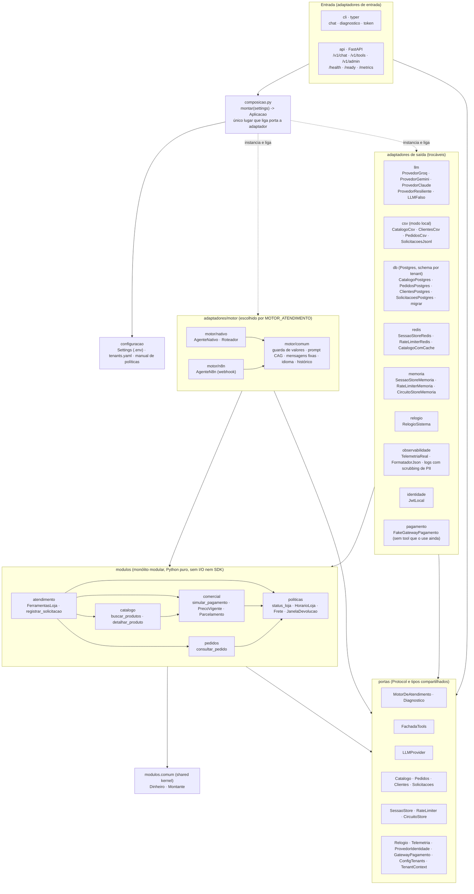

# 01 · Arquitetura em runtime

*EN: Runtime architecture: modular monolith, ports and adapters, composition root (import rules C1–C5).*

Mostra o monólito modular (`modulos/`), as portas (`portas/`), os adaptadores de entrada e de saída
(`adaptadores/`) e o `composicao.py`, que é o único lugar que liga porta a adaptador. Base:
[`docs/arquitetura.md`](../arquitetura.md) §3 e §3.3.

**Legenda:** seta contínua = "importa" (dependência). Seta pontilhada = "instancia e liga" (só `composicao.py`).
Todas as setas de dependência descem: entrada → composição → adaptadores → módulos → portas → `comum`. Isso é a
regra de camadas do import-linter (C1), e ninguém sobe.

## Regras de dependência (import-linter, `pyproject.toml` `[tool.importlinter]`)

| Regra | O que o diagrama mostra |
|---|---|
| **C1** camadas | Setas só descem. `portas` e `modulos.comum` não importam nada de fora. |
| **C2** sem SDK em `modulos`/`portas` | Os SDKs (groq, google, anthropic, sqlalchemy, redis, fastapi) ficam só nos adaptadores. |
| **C3** entre módulos | `atendimento` e as outras setas entre módulos vão só para `aplicacao` (não há seta para `dominio`). |
| **C4** entrada | `cli` e `api` só têm setas para `composicao` e `portas`. |
| **C5** adaptadores independentes | Nenhuma seta entre `llm`, `csv`, `db`, `redis`, `memoria`… `motor/nativo` e `motor/n8n` não se conhecem; ambos usam só `motor/comum`. |

## Componentes e onde existem

| Componente no diagrama | Onde está |
|---|---|
| `cli` (typer), comandos `chat`, `diagnostico`, `token`, `versao` | `src/emporio/adaptadores/cli/__init__.py`, script `emporio` em `pyproject.toml` |
| `api` (FastAPI), `/v1/chat`, `/v1/tools`, `/v1/admin`, `/health`, `/ready`, `/metrics` | `src/emporio/adaptadores/api/app.py` (`criar_app`) |
| `composicao.py` (`montar`, `montar_ferramentas`, `Aplicacao`) | `src/emporio/composicao.py` |
| `configuracao` (`Settings`, `carregar_tenants`) e `config/tenants.yaml` | `src/emporio/configuracao/`, `config/tenants.yaml`, `config/tenants/emporio/politicas.md` |
| `motor/nativo` (`AgenteNativo`, `Roteador`) | `src/emporio/adaptadores/motor/nativo/agente.py`, `roteador.py` |
| `motor/n8n` (`AgenteN8n`) | `src/emporio/adaptadores/motor/n8n/agente.py` |
| `motor/comum` (`guarda.py`, `prompt.py`, `mensagens.py`, `idioma.py`, `historico.py`) | `src/emporio/adaptadores/motor/comum/` |
| `llm` (`ProvedorGroq`, `ProvedorGemini`, `ProvedorClaude`, `ProvedorResiliente`, `LLMFalso`) | `src/emporio/adaptadores/llm/` (`groq.py`, `gemini.py`, `claude.py`, `resiliencia.py`, `falso.py`) |
| `csv` (`CatalogoCsv`, `ClientesCsv`, `PedidosCsv`, `SolicitacoesJsonl`) | `src/emporio/adaptadores/csv/` |
| `db` (`CatalogoPostgres` e os outros repositórios, `migrar`, `AcessoTenant`) | `src/emporio/adaptadores/db/` |
| `redis` (`SessaoStoreRedis`, `RateLimiterRedis`, `CatalogoComCache`, `GuardaRedis`) | `src/emporio/adaptadores/redis/` |
| `memoria` (`SessaoStoreMemoria`, `RateLimiterMemoria`, `CircuitoStoreMemoria`) | `src/emporio/adaptadores/memoria/` |
| `relogio` (`RelogioSistema`) | `src/emporio/adaptadores/relogio/relogio.py` |
| `observabilidade` (`TelemetriaReal`, `FormatadorJson`) | `src/emporio/adaptadores/observabilidade/` |
| `identidade` (`JwtLocal`) | `src/emporio/adaptadores/identidade/jwt_local.py` |
| `pagamento` (`FakeGatewayPagamento`) | `src/emporio/adaptadores/pagamento/fake.py` (montado em `Aplicacao.pagamento`; nenhuma tool o usa hoje) |
| `modulos/atendimento`, `catalogo`, `comercial`, `pedidos`, `politicas`, `comum` | `src/emporio/modulos/<nome>/` (`dominio.py` e `aplicacao.py`) |
| Portas (`MotorDeAtendimento`, `LLMProvider`, `FachadaTools`, `Catalogo`…, `SessaoStore`, `RateLimiter`, `CircuitoStore`, `Relogio`, `Telemetria`, `ProvedorIdentidade`, `GatewayPagamento`, `ConfigTenants`) | `src/emporio/portas/` |

As setas entre módulos (`ATE --> CAT` etc.) são os imports reais de `modulos/*/aplicacao.py`. Por exemplo,
`atendimento/aplicacao.py` importa `catalogo.aplicacao`, `comercial.aplicacao`, `pedidos.aplicacao` e
`politicas.aplicacao`.
