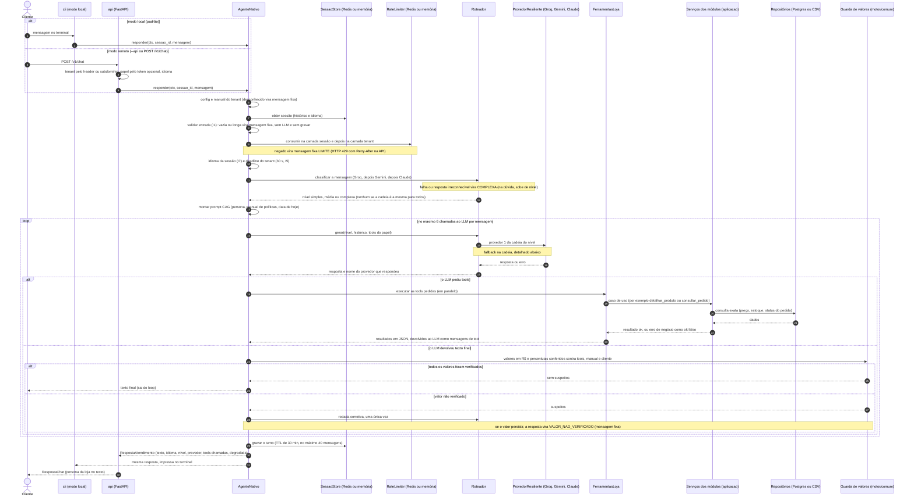
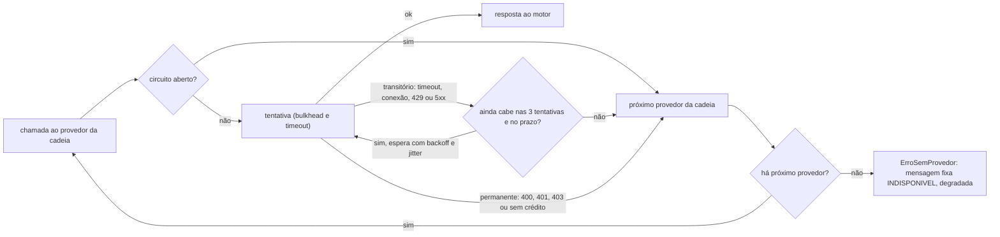

# 02 · Sequência de uma mensagem

*EN: Sequence of one customer message: entry, motor, rate limit, router, LLM with fallback, tools, value guard, reply.*

Uma mensagem do cliente = um turno do `AgenteNativo` (`MotorDeAtendimento`). Mostra o caminho feliz e as
ramificações de falha. A parte de fallback e degradação está detalhada depois do diagrama. Base:
[`docs/arquitetura.md`](../arquitetura.md) §2, §3.2, §5.1 e §5.2; fluxo real em
`src/emporio/adaptadores/motor/nativo/agente.py` (`AgenteNativo._responder`).

> Com `MOTOR_ATENDIMENTO=n8n` o passo "LLM" vira um `POST` ao webhook do n8n, e as tools voltam pela API em
> `/v1/tools/{nome}`. A guarda de valores e as mensagens fixas continuam no Python (`motor/n8n/agente.py`).

## Fallback da cadeia de LLMs (`Roteador` e `ProvedorResiliente`)

Cadeias por nível (`CADEIAS` em `motor/nativo/roteador.py`): simples = Groq, Gemini, Claude. Média = Gemini, Claude,
Groq. Complexa = Claude, Gemini, Groq. Provedores sem chave saem da cadeia. Se a cadeia tiver um provedor só, o
fallback não existe, e o caminho de falha é o mesmo.

- Erro permanente (`401`/`403`, chave expirada, sem crédito) **abre o circuito na hora** e não repete.
- Erro transitório repete no máximo 3 vezes, com `wait_random_exponential` (base 0,5 s, teto 4 s).
- Circuito: fechado → aberto → meio-aberto, em memória por réplica (`CircuitoStoreMemoria`).
- Prazo esgotado (`ErroPrazoEsgotado`) para na hora e vira mensagem fixa `DEADLINE`.

## Degradação: o que o cliente recebe

| Situação | O que acontece | `codigo` na resposta | `degradada` |
|---|---|---|---|
| Mensagem vazia ou acima de `tamanho_max_mensagem` | Mensagem fixa, sem LLM, sem gravar na sessão | `entrada_invalida` | não |
| Rate limit (sessão, tenant ou LLM) | Mensagem fixa; a API responde 429 com `Retry-After` | `limite` | sim |
| Prazo do tenant (30 s) estourado | Turno cancelado, a mensagem fixa é gravada no histórico | `deadline` | sim |
| Todos os provedores da cadeia falharam ou estão com circuito aberto | Mensagem fixa de indisponibilidade | `indisponivel` | sim |
| Tool com erro de negócio (ex.: pedido não encontrado) | Erro volta ao LLM como resultado de tool, que responde ao cliente sem inventar | segue normal | não |
| Guarda de valores pegou um preço ou percentual sem fonte | Uma rodada corretiva; se persistir, mensagem fixa | `erro` | sim |
| Limite de 6 chamadas ao LLM atingido | Mensagem fixa | `erro` | sim |
| Falha inesperada no turno ou fora dele (rede de segurança, `responder` nunca lança) | Mensagem fixa genérica | `erro` | sim |
| Redis indisponível | Rate limit com bucket local (fail-open); sessão sem histórico (`GuardaRedis`) | segue normal | não |
| Postgres indisponível | A tool captura a exceção e devolve `ok` falso com erro interno (`FerramentasLoja.executar`). O LLM recebe o erro e responde sem inventar o dado. Se a falha sair do turno, vira mensagem fixa `erro` | segue normal, ou `erro` | não, ou sim |

Os textos das mensagens fixas vêm de `motor/comum/mensagens.py` (`ChaveMensagem`), traduzidos pelo idioma da sessão.
Eles não passam pelo LLM, então funcionam mesmo com todos os provedores fora.

## Componentes e onde existem

| Componente | Onde está |
|---|---|
| `cli` (modo local e `--api`), `api` (`POST /v1/chat`) | `src/emporio/adaptadores/cli/__init__.py`, `src/emporio/adaptadores/api/app.py` |
| `AgenteNativo.responder` (I1 a I8, deadline, guarda, gravação) | `src/emporio/adaptadores/motor/nativo/agente.py` |
| `RateLimiter` (camadas `sessao` e `tenant`) | `src/emporio/adaptadores/memoria/rate_limit.py` e `src/emporio/adaptadores/redis/rate_limit.py` |
| `SessaoStore` (histórico, idioma, TTL de 30 min) | `src/emporio/adaptadores/memoria/sessao.py` e `src/emporio/adaptadores/redis/sessao.py` |
| `Roteador` (classificador, `CADEIAS`, `ORDEM_CLASSIFICADOR`) | `src/emporio/adaptadores/motor/nativo/roteador.py` |
| `ProvedorResiliente` (circuito, bulkhead, timeout, tenacity) | `src/emporio/adaptadores/llm/resiliencia.py` |
| `CircuitoStoreMemoria` | `src/emporio/adaptadores/memoria/circuito.py` |
| Prompt CAG (`montar_prompt`) | `src/emporio/adaptadores/motor/comum/prompt.py` |
| `FerramentasLoja` (6 tools: `buscar_produtos`, `detalhar_produto`, `simular_pagamento`, `consultar_pedido`, `status_loja`, `registrar_solicitacao`) | `src/emporio/modulos/atendimento/aplicacao.py` |
| Casos de uso (`ServicoCatalogo`, `ServicoComercial`, `ServicoPedidos`, `ServicoPoliticas`, `ServicoAtendimento`) | `src/emporio/modulos/*/aplicacao.py` |
| Repositórios (`CatalogoPostgres`…, `CatalogoCsv`…) e cache (`CatalogoComCache`) | `src/emporio/adaptadores/db/repositorios.py`, `src/emporio/adaptadores/csv/`, `src/emporio/adaptadores/redis/cache_catalogo.py` |
| Guarda de valores (`valores_nao_verificados`, `nota_correcao`) | `src/emporio/adaptadores/motor/comum/guarda.py` |
| Métricas do turno (`emporio_roteamento_total`, `emporio_llm_fallback_total` etc.) | `src/emporio/adaptadores/observabilidade/telemetria.py` |
