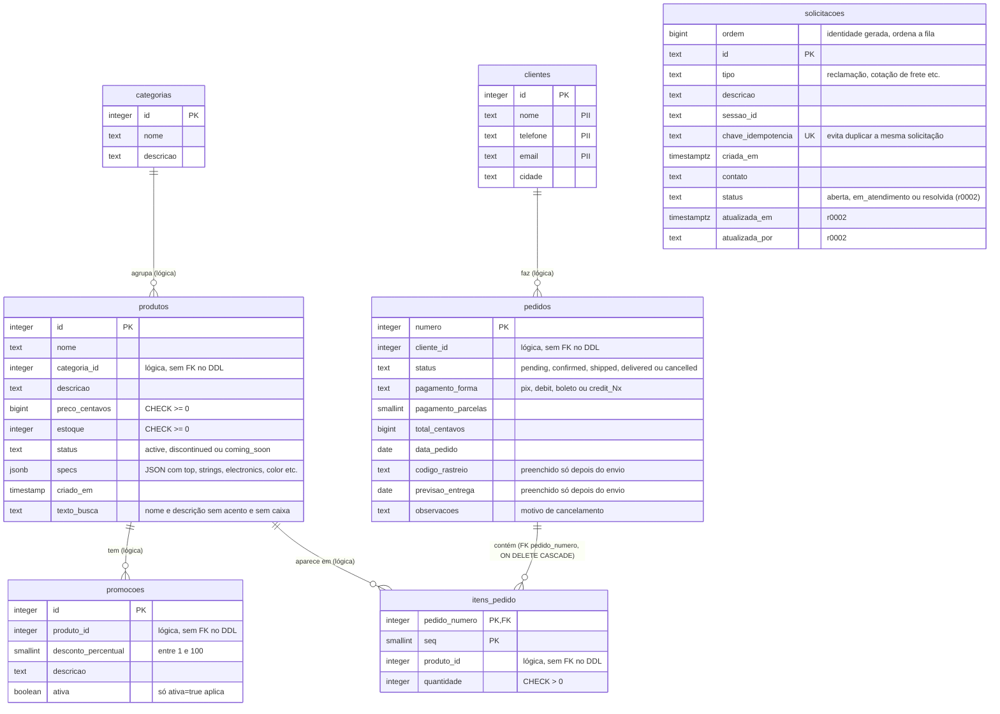

# 03 · Modelo de dados (ERD)

*EN: Data model (ERD) of the per-tenant schema: categories, products, promotions, customers, orders, order items, requests.*

Tabelas do schema de **um tenant** (ex.: `emporio`). Colunas conferidas em
`src/emporio/adaptadores/db/migracoes/versions/r0001_inicial.py` e `r0002_status_solicitacoes.py`.

**Cada tenant tem seu próprio schema.** As tabelas são idênticas em todos os schemas e não têm coluna `tenant_id`.
A conexão fixa o `search_path` do tenant (`AcessoTenant` em `db/_acesso.py`, e `migrar` aplica as migrações em loop
por schema). Assim, nenhuma consulta é feita sem tenant. Valores monetários ficam em centavos (`bigint`).

**Relações:** as linhas **sólidas** (`FK`) existem no DDL (só `itens_pedido` → `pedidos`). As demais são **relações
lógicas**: as colunas existem, mas o DDL não tem `REFERENCES`, então o banco não as garante. Estão marcadas como
"lógica" no próprio diagrama.

## Notas

- **Índices** (além das PKs): `ix_produtos_categoria`, `ix_produtos_preco`, `ix_promocoes_produto`,
  `ix_solicitacoes_status`. A coluna `chave_idempotencia` é `UNIQUE`.
- **`solicitacoes` não tem relação com as outras tabelas.** Ela guarda `sessao_id` e `contato` como texto. Em modo
  local (sem Postgres), o mesmo registro vai para `var/` em JSONL (`SolicitacoesJsonl`). O formato é outro, mas os
  campos são os mesmos.
- **Promoções:** um produto pode ter várias linhas em `promocoes` (ex.: 93, 96, 99). Só `ativa = true` entra no
  cálculo do preço vigente, e promoções não se somam.
- **PII:** `clientes` (nome, telefone, e-mail) e `pedidos` ligados a eles. `consultar_pedido` não revela dados do
  pedido sem número mais e-mail ou telefone do cadastro (`modulos/pedidos/aplicacao.py`). A arquitetura (§7) proíbe
  mandar conteúdo de mensagem e dados de cliente para logs e telemetria.
- **Sem tabela de configuração:** a persona, o manual e os limites de cada loja ficam em `config/tenants.yaml` e em
  `config/tenants/<id>/politicas.md`, não no banco.

## Componentes e onde existem

| Tabela | Migração | Repositório |
|---|---|---|
| `categorias`, `produtos`, `promocoes` | `r0001_inicial.py` | `CatalogoPostgres` (`db/repositorios.py`) |
| `clientes` | `r0001_inicial.py` | `ClientesPostgres` |
| `pedidos`, `itens_pedido` | `r0001_inicial.py` | `PedidosPostgres` |
| `solicitacoes` (+ `status`, `atualizada_em`, `atualizada_por` em `r0002`) | `r0001_inicial.py` e `r0002_status_solicitacoes.py` | `SolicitacoesPostgres` |
| Seed dos CSVs no schema | `db/seed.py` | `db/migrar.py` (aplica as migrações e o seed) |
