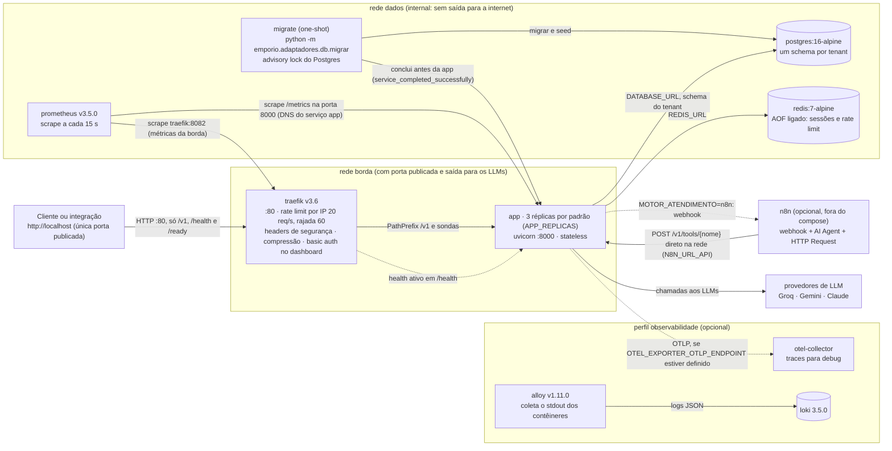
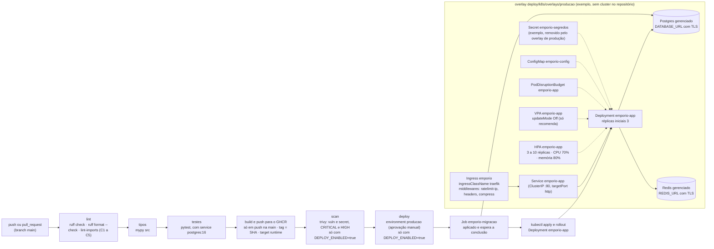

# 04 · Deploy, observabilidade e CI/CD

*EN: Deployment: Traefik, app replicas, Postgres and Redis, migrate job, Prometheus scraping /metrics, optional n8n, CI/CD pipeline and the Kubernetes example.*

Base: [`docs/deploy.md`](../deploy.md), `docker-compose.yml`, `.github/workflows/ci-cd.yml`, `deploy/k8s/`,
`deploy/observabilidade/prometheus/prometheus.yml`. Este diagrama mostra só o que existe no repositório.
**Grafana e Sentry não aparecem:** ficaram para o futuro (ver `docker-compose.yml`, comentário do topo).

## 4.1 Docker Compose (conjunto essencial e perfil `observabilidade`)

- **Entrada única:** só o Traefik publica porta. `/metrics` **não** passa pela borda: o Prometheus raspa pela rede
  interna. O Traefik não roteia `/metrics` nem outros caminhos que não sejam `/v1`, `/health` e `/ready`.
- **Escala:** `APP_REPLICAS=5 docker compose up -d`. O Traefik descobre as réplicas pelo DNS do serviço e pelas
  labels. Não há sticky session.
- **Ordem de subida:** `postgres` fica saudável, `migrate` roda e termina com sucesso, e só então `app` sobe (ela
  também espera `postgres` e `redis` saudáveis).
- **Métricas da app (contrato, `docs/deploy.md` §6):** `emporio_http_requisicoes_total`, `emporio_llm_fallback_total`,
  `emporio_circuito_estado` e as demais métricas `emporio_*`, com o rótulo `tenant_id`. Sem `session_id` como rótulo.
- **Sem a `observabilidade`:** a app e o Traefik continuam funcionando. Só registram erros de conexão com o collector.

## 4.2 CI/CD (`.github/workflows/ci-cd.yml`) e Kubernetes de exemplo

- **Gates:** lint, tipos e testes rodam em todo push e pull request. O build só roda em push na `main`. O scan e o
  deploy só rodam com `DEPLOY_ENABLED=true` (desligado por padrão). O deploy é um **exemplo**: não há cluster.
- **Migração antes do rollout:** o Job é imutável, então a pipeline o recria antes de aplicar os manifestos. Se a
  migração falhar, o deploy é abortado. Por isso as migrações precisam ser compatíveis com a versão anterior
  (expand e contract).
- **Traefik no Kubernetes:** é o Ingress Controller, instalado por Helm (instrução em `docs/deploy.md` §5). Não há
  chart no repositório.
- **Prometheus e Grafana:** não há manifesto de Prometheus no `deploy/k8s/`. O diagrama de Kubernetes não mostra nenhum.

## Componentes e onde existem

| Componente | Onde está |
|---|---|
| Traefik (borda, labels, rate limit, basic auth) | `docker-compose.yml` (serviço `traefik`), `deploy/traefik/usuarios.htpasswd` |
| `app` (3 réplicas por padrão, `APP_REPLICAS`) | `docker-compose.yml` (serviço `app`), `Dockerfile` (target `runtime`) |
| `migrate` (`python -m emporio.adaptadores.db.migrar`) | `docker-compose.yml` (serviço `migrate`), `src/emporio/adaptadores/db/migrar.py` |
| `postgres:16-alpine`, `redis:7-alpine` | `docker-compose.yml` |
| Prometheus, scrape de `app:8000` e `traefik:8082` | `docker-compose.yml` (serviço `prometheus`), `deploy/observabilidade/prometheus/prometheus.yml` |
| `/metrics` na app (`emporio_*`) | `src/emporio/adaptadores/api/app.py` (rota `/metrics`), `src/emporio/adaptadores/observabilidade/telemetria.py` |
| `/health`, `/ready` | `src/emporio/adaptadores/api/app.py` |
| n8n (`AgenteN8n`, `/v1/tools`) | `src/emporio/adaptadores/motor/n8n/agente.py`, `src/emporio/adaptadores/api/app.py` (`/v1/tools`), `deploy/n8n/workflow-atendimento.json`, `deploy/n8n/README.md` |
| Perfil `observabilidade`: `otel-collector`, `loki`, `alloy` | `docker-compose.yml`, `deploy/observabilidade/otel-collector/`, `loki/`, `alloy/` |
| Pipeline: lint, tipos, testes, build GHCR, scan trivy, deploy | `.github/workflows/ci-cd.yml` |
| Manifestos K8s (Ingress, Service, Deployment, HPA, VPA, PDB, ConfigMap, Secret de exemplo, Job) | `deploy/k8s/base/` e `deploy/k8s/overlays/producao/` |
